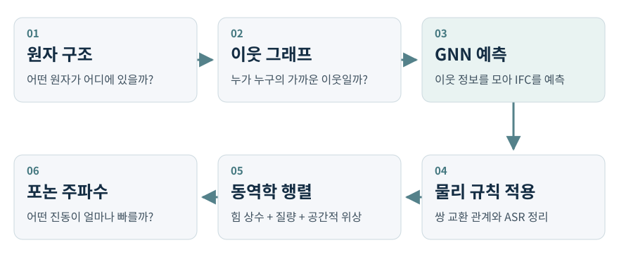
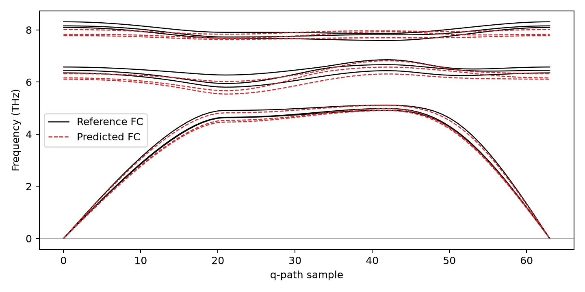

# 공과 용수철로 이해하는 Phonon GNN

**원자 구조에서 힘 상수를 배우고, 물질의 진동을 계산하는 이야기**

이 문서는 `donghoonst/phononh_gnn`을 처음 읽는 사람을 위한 설명서입니다. 어려운 이름을 먼저 외우기보다, 작은 장면을 하나씩 상상하면서 코드까지 따라갑니다. 수식은 맨 뒤의 선택 부록에 모았습니다.

> **현재 프로젝트의 위치**
>
> 직접 만든 연습용 데이터에서 학습, 힘 상수 예측, 포논 계산까지 실행됩니다. 실제 DFT 데이터에서 새로운 물질을 정확히 예측하는지는 아직 검증하지 않았습니다. 이 문서에서 “실행된다”와 “실제 물질에 정확하다”는 서로 다른 뜻입니다.

설명 기준은 코드 검토 당시의 [커밋 `9453ed0`](https://github.com/donghoonst/phononh_gnn/commit/9453ed0572911beb34be3d9bbcb370f36bf2742d)입니다. 아래의 결함 설명도 이 버전을 기준으로 합니다. 수정안이 이미 적용되었다는 뜻은 아닙니다.

## 읽는 순서

| 궁금한 것 | 읽을 곳 |
|---|---|
| 이 연구가 무엇을 하는지 | 1–3장 |
| GNN이 어떻게 배우는지 | 4–7장 |
| 실제 코드와 노트북을 보는 방법 | 8–9장 |
| 결과가 얼마나 믿을 만한지 | 10–11장 |
| 앞으로 무엇을 고칠지 | 12장 |
| 수식, 용어, 더 자세한 근거 | 부록 A–D |

처음에는 각 장의 이야기만 읽어도 됩니다. 두 번째 읽을 때 코드와 수식을 연결해 보세요.

## 1. 책상 위에 작은 공들이 줄지어 있다고 생각해 봅시다

작은 공들을 용수철로 연결해 책상 위에 놓았습니다. 공 하나를 살짝 밀면 그 공만 움직이지 않습니다. 연결된 용수철을 통해 옆 공도 움직이고, 그 옆 공도 움직입니다.

물질 속 원자도 이와 비슷하게 서로 영향을 주고받습니다.

| 상상 속 물건 | 실제 연구에서 대응하는 것 |
|---|---|
| 작은 공 | 원자 |
| 공의 무게 | 원자 질량 |
| 공이 놓인 자리 | 원자 위치 |
| 서로 당기고 미는 연결 | 원자 사이의 상호작용 |
| 함께 흔들리는 모습 | 결정의 진동 |

물론 원자 사이에 진짜 금속 용수철이 달려 있는 것은 아닙니다. 전자와 원자핵의 상호작용을, **원자가 조금 움직이는 범위에서** 용수철처럼 이해하는 것입니다. 이것을 조화 근사라고 부릅니다.

이제 같은 공 두 개를 다른 용수철에 연결해 봅시다. 단단한 용수철은 보통 더 빠른 진동을 만들고, 무거운 공은 같은 용수철에서 더 느리게 움직입니다. 따라서 진동을 알려면 적어도 두 가지를 알아야 합니다.

1. 공들이 서로 얼마나 강하게 영향을 주는가.
2. 각 공이 얼마나 무거운가.

이 프로젝트는 첫 번째 정보를 원자 구조로부터 배우려 합니다. 두 번째 정보인 원자 질량은 뒤의 진동 계산에 사용합니다.

## 2. 원자 사이의 관계를 적은 표가 IFC입니다

공 A를 오른쪽으로 조금 밀었을 때 공 B가 얼마나 반응하는지 적어 보겠습니다. 밀어 본 방향과 힘을 관찰하는 방향을 바꾸면 더 많은 정보가 생깁니다.

실제 원자는 세 방향으로 움직일 수 있습니다.

- x: 좌우
- y: 앞뒤
- z: 위아래

“움직인 방향 3가지”와 “힘을 읽는 방향 3가지”를 조합하면 9칸짜리 표가 됩니다.

| 힘을 관찰하는 방향 | 이웃을 x로 이동 | 이웃을 y로 이동 | 이웃을 z로 이동 |
|---|---|---|---|
| x 방향 힘 | xx | xy | xz |
| y 방향 힘 | yx | yy | yz |
| z 방향 힘 | zx | zy | zz |

이 표 하나가 원자 쌍에 대한 **3×3 힘 상수 블록**입니다. 코드에서는 보통 `fc`, `pairs`, `target` 같은 이름으로 등장합니다.

**IFC**는 원자간 힘 상수, **IFC2**는 에너지를 변위로 두 번 미분해서 얻는 2차 힘 상수입니다. 직관적으로는 “조금 움직였을 때 힘이 얼마나 변하는지 적은 표”입니다. 엄밀한 부호 관계는 힘 변화율에 음수를 붙인 값이며, 부록 A에서 설명합니다.

여기에서 중요한 점이 있습니다. 연결 하나를 단순한 숫자 하나로 표현하면 “어느 방향으로 밀었는가”를 충분히 설명하기 어렵습니다. 그래서 현재 모델은 방향을 가진 9개의 정보를 예측합니다.

또한 IFC의 음수 원소 하나만 보고 “잘못된 용수철”이라고 판단하면 안 됩니다. 원자 쌍의 상호작용을 나눠 적는 과정에서 음수 성분은 자연스럽게 나타납니다. 물질 전체가 안정한지는 완성된 진동 문제를 보고 판단해야 합니다.

## 3. 응답표를 모으면 물질이 흔들리는 방법을 찾을 수 있습니다

여러 사람이 긴 줄을 잡고 있다고 상상해 봅시다. 모두 같은 방향으로 움직일 수도 있고, 한 사람씩 조금 늦게 움직여 물결을 만들 수도 있습니다. 물질 속 원자에도 여러 집단적인 진동 패턴이 있습니다.

힘 상수 표들을 모으고 원자 질량까지 고려하면, 가능한 진동 패턴과 그 빠르기를 계산할 수 있습니다. 이때 만드는 계산표를 **동역학 행렬**이라고 부릅니다.

여기서 두 가지 말이 등장합니다.

- **모드(mode)**: 원자들이 함께 움직이는 하나의 방식
- **주파수(frequency)**: 그 방식으로 얼마나 빠르게 반복해서 움직이는지

포논은 양자역학에서 결정 진동의 에너지를 세는 기본 단위입니다. 이 프로젝트에서는 그 바탕이 되는 진동 주파수와 분산 관계를 계산합니다. 처음에는 “원자들의 집단 진동을 연구한다”라고 이해하면 충분합니다.

**포논 분산**은 서로 다른 공간적 물결 패턴에서 진동 주파수가 어떻게 달라지는지 보여 주는 그래프입니다. 공간적 물결의 방향과 반복 간격을 나타내는 값이 `q-point`입니다. q-point는 시간이나 원자 번호가 아닙니다.

전체 흐름은 다음과 같습니다.



이 그림에서 GNN이 직접 배우는 것은 **힘 상수**입니다. 그 뒤의 동역학 행렬과 주파수는 정해진 물리 계산으로 얻습니다. 따라서 “신경망이 그래프의 곡선을 바로 그린다”라고 이해하면 실제 코드와 다릅니다.

전통적인 방법에서는 DFT라는 전자구조 계산으로 여러 변위 구조의 힘을 구하거나, 전자계의 응답을 계산해 힘 상수를 얻습니다. 정확한 계산에는 비용이 듭니다. 이 프로젝트는 그런 데이터를 충분히 배운 모델이 새로운 구조의 힘 상수를 빠르게 예측할 수 있는지 연구합니다. 다만 현재 저장된 학습 결과는 DFT 데이터가 아닌 합성 데이터에서 나왔습니다.

## 4. GNN은 원자들이 이웃의 소식을 나누는 방법입니다

한 집의 환경을 알려면 그 집만 봐서는 부족할 수 있습니다. 근처에 어떤 집이 있고, 얼마나 가까우며, 어느 방향에 있는지도 중요합니다.

원자도 마찬가지입니다. 같은 원소라도 주변 원자의 종류와 배치가 달라지면 힘 상수가 달라질 수 있습니다. **그래프 신경망(GNN)**은 이런 이웃 관계를 다루는 신경망입니다.

그래프에서 점을 노드, 점을 잇는 연결을 엣지라고 부릅니다.

| 그래프 표현 | 여기에서의 뜻 |
|---|---|
| 노드 | 원자 |
| 엣지 | 가까운 원자 또는 주기적 이미지와의 관계 |
| 노드 특징 | 원소 종류와 학습된 주변 환경 정보 |
| 엣지 특징 | 거리와 방향 |

### 먼저 원소의 이름표를 숫자로 바꿉니다

모델은 “탄소”, “산소”라는 글자를 그대로 계산하지 않습니다. 원자 번호를 받아 학습 가능한 숫자 묶음으로 바꿉니다. 이것이 **임베딩(embedding)**입니다.

숫자 묶음은 처음부터 정해진 화학 법칙이 아닙니다. 정답과 비교하며 학습되는 표현입니다. 코드에서는 `nn.Embedding`이 이 역할을 합니다.

### 다음으로 이웃의 소식을 모읍니다

원자 j의 특징에 거리와 방향을 결합해 원자 i로 보낼 메시지를 만듭니다. 현재 기본 메시지의 재료는 **이웃 원자 j의 특징, 거리, 방향**입니다. 중심 원자 i의 특징은 뒤의 attention 점수 등에 사용됩니다.

여러 메시지를 모으면 “이 원자 주변에 무엇이 있는가”를 나타내는 정보가 됩니다. 한 번 갱신한 특징으로 다시 소식을 나누면, 이웃의 이웃 정보도 영향을 줄 수 있습니다. 이 반복 단계가 layer입니다.

단, 여러 layer를 쓴다고 이 코드의 출력 cutoff가 저절로 무한히 늘어나지는 않습니다. 주변 환경을 더 넓게 참고하는 것과, 멀리 떨어진 원자 쌍의 IFC를 직접 출력하는 것은 구분해야 합니다.

### 합계와 집중해서 듣기를 함께 사용합니다

현재 모델에는 두 종류의 집계가 있습니다.

- **합산(sum)**: 이웃의 메시지를 더합니다. 이웃 수와 누적 정보를 담을 수 있습니다.
- **어텐션(attention)**: 상황에 따라 어떤 이웃의 메시지를 더 중요하게 볼지 가중치를 정합니다.

세 사람이 같은 의견을 낸 경우와 서른 사람이 같은 의견을 낸 경우를 생각해 보세요. 평균 의견은 같을 수 있지만 사람 수는 다릅니다. 정규화된 attention만으로는 이런 수의 정보가 줄어들 수 있어, 기본 모델은 합산 경로도 함께 둡니다.

어텐션이 “중요한 원자를 과학적으로 설명해 주는 답”은 아닙니다. 예측을 돕도록 학습되는 가중치입니다. 그 값만으로 인과관계를 단정할 수는 없습니다.

### 여러 이웃의 정보를 함께 결합합니다

주변 환경은 이웃 하나씩의 영향만으로 설명되지 않을 수 있습니다. 코드의 `correlation`은 모인 특징끼리 곱으로 결합해 더 복잡한 관계를 만들게 합니다.

이것은 다체 정보를 표현하기 위한 장치입니다. 현재 구현은 재귀적인 tensor product이며, MACE의 완전한 다체 기저를 그대로 구현한 것은 아닙니다.

## 5. 결정의 끝에는 벽이 아니라 다음 무늬가 이어집니다

바닥 타일을 생각해 봅시다. 작은 무늬 하나가 좌우와 앞뒤로 반복되어 큰 바닥을 만듭니다. 결정도 작은 기본 구조가 공간에 반복되는 것으로 다룹니다.

계산에서는 무한히 많은 원자를 전부 저장할 수 없습니다. 그래서 작은 단위 셀을 저장하고, 바깥에는 같은 구조가 계속 이어진다고 가정합니다. 이것이 **주기적 경계조건(PBC)**입니다.

상자 오른쪽 끝의 원자는 왼쪽 상자의 복사본에 있는 원자와 가까울 수 있습니다. 따라서 코드가 이웃을 찾을 때는 상자 안만 보면 안 됩니다. 옆 상자의 원자 이미지도 고려해야 합니다.

### 같은 원자 번호라도 어느 상자인지 알아야 합니다

원자 A와 B라는 이름만으로는 관계가 완전히 정해지지 않습니다.

- 내 상자 안의 B
- 오른쪽 상자 안의 B
- 위쪽 상자 안의 B

이들은 같은 종류의 주기적 복사본이지만 서로 다른 상대 위치를 가집니다. 코드의 `pair_shift`는 어느 주기적 이미지인지 구분하는 정수 이동 정보입니다.

### 가까운 이웃만 다루는 기준이 cutoff입니다

현재 작은 설정에는 두 거리가 있습니다.

| 설정 | 기본 실습 값 | 역할 |
|---|---:|---|
| `conv_cutoff` | 4.5 Å | 원자 특징을 갱신할 메시지 이웃 범위 |
| `pair_cutoff` | 5.5 Å | 힘 상수를 출력할 대상 범위 |

Å은 옹스트롬이며 원자 사이의 거리를 나타내는 작은 길이 단위입니다. 1 Å은 1 m의 100억 분의 1입니다.

멀리 있는 원자의 영향이 실제로 항상 0인 것은 아닙니다. cutoff는 계산을 유한하게 하기 위한 근사입니다. 실제 물질에서는 이 거리를 늘려 가며 결과가 충분히 안정되는지 확인해야 합니다.

### compact는 반복되는 정보를 접어서 저장한 형태입니다

큰 초격자 안에는 반복 관계로 연결된 힘 상수 정보가 많습니다. Phonopy의 compact 형식은 primitive 원자를 기준으로 필요한 정보를 저장합니다.

여러 최단 이미지가 compact 항 하나에 대응할 수도 있습니다. 이때 **합계만 안다고 각 이미지의 몫을 유일하게 알 수 있는 것은 아닙니다.** 세 상자의 사탕이 모두 12개라는 사실만으로 각 상자에 몇 개씩 있는지 정할 수 없는 것과 같습니다.

현재 모델은 이미지별 값을 만든 뒤 합쳐 compact 값을 맞춥니다. 이 때문에 이미지별 예측을 독립적인 물리적 정답으로 해석할 때 주의해야 합니다. 11장에서 다시 연결하겠습니다.

## 6. 지도를 돌리면 화살표도 같이 돌아야 합니다

책상 위 공과 용수철 전체를 90도 돌렸다고 생각해 봅시다. 물건 자체는 그대로입니다. 방향을 표시하는 화살표만 새 좌표에 맞게 돌아야 합니다.

모델도 이 규칙을 따라야 합니다. 구조를 돌렸을 때 힘 상수 표가 엉뚱하게 바뀌면, 같은 물질을 바라보는 방향만 바꿔도 다른 답을 내놓게 됩니다.

이처럼 **입력이 변환되면 출력도 정해진 방식으로 함께 변환되는 성질**을 등변성(equivariance)이라고 부릅니다.

현재 모델은 `e3nn`이라는 라이브러리를 사용합니다. 이 라이브러리는 회전·반전 시 특징이 어떻게 바뀌는지 정한 규칙 안에서 연산을 만듭니다. 방향 성분을 아무 숫자와 무작정 섞는 방식이 아닙니다.

### 숫자에도 종류가 있습니다

온도처럼 방향이 없는 숫자와 화살표처럼 방향이 있는 숫자는 다르게 다뤄야 합니다. 현재 모델도 특징을 회전 법칙에 따라 구분합니다.

최종 3×3 IFC 표의 9개 자유도는 다음과 같이 나뉩니다.

| 성분 | 개수 | 처음 읽을 때의 이해 |
|---|---:|---|
| `0e` | 1 | 방향에 공통인 등방 성분 |
| `1e` | 3 | 표의 반대칭 부분에 해당하는 성분 |
| `2e` | 5 | 대칭 부분에서 방향별 차이를 담는 성분 |

합하면 1 + 3 + 5 = 9입니다. `1e`는 축벡터 변환을 따르며, 원자 사이 실제 힘 벡터 그 자체를 뜻하지 않습니다. 기호의 자세한 의미는 부록에 두었습니다.

### 원자 메모와 원자 쌍 메모를 함께 씁니다

현재 모델에는 원자별 특징뿐 아니라, 힘 상수를 예측할 이미지별 pair 특징도 있습니다. 두 원자 사이의 관계를 적은 별도 메모라고 생각할 수 있습니다.

기본 설정에서는 layer가 바뀔 때 이 메모도 계속 갱신합니다. 이것이 `persistent_pair`입니다. `enhanced_fusion`은 기존 pair 메모와 새 원자 환경을 곱으로 결합하는 추가 장치입니다.

모든 메시지 엣지가 이런 persistent 메모를 가진다는 뜻은 아닙니다. 이 구현에서는 출력 대상 pair/image에 해당합니다.

`independent_heads=True`이면 대칭 성분과 반대칭 성분을 위해 전체 backbone을 두 개 사용합니다. 작은 출력 버튼만 두 개 만드는 옵션이 아니므로 모델 크기가 크게 늘어납니다.

## 7. 예측한 표를 물리 규칙에 맞게 정리합니다

신경망이 9칸짜리 표를 만들었다고 바로 모든 물리 규칙을 만족하는 것은 아닙니다. 현재 코드는 예측 뒤에 몇 가지 규칙을 직접 적용합니다.

### 모두 같이 이동해도 상대적인 배치는 같습니다

책상 위 모든 공을 같은 방향으로 같은 거리만큼 옮겼습니다. 공 사이 거리는 그대로입니다. 원래 평형 상태였다면 이런 전체 병진만으로 내부에서 새로운 복원력이 생기면 안 됩니다.

힘 상수의 합이 이 조건에 맞도록 하는 것이 **음향 합 규칙(ASR)**입니다. 현재 코드는 다른 원자와의 힘 상수를 모은 뒤, 자기 자신에 대한 항인 onsite를 그 합의 음수로 정합니다.

```python
onsite = -fc.sum(1)
```

이 한 줄이 “행의 전체 합을 0으로 맞춘다”는 뜻입니다. `fc`는 이 시점에 offsite 항을 넣어 둔 배열입니다.

### 원자 쌍을 바꿔 읽어도 서로 맞아야 합니다

A와 B의 관계를 읽는 표와 B와 A의 관계를 읽는 표는 방향과 주기적 이동을 함께 바꾸면 서로 대응해야 합니다. 코드에서는 reverse 쌍의 transpose와 평균을 냅니다.

이것은 모든 개별 3×3 블록을 자기 transpose와 같게 만든다는 뜻이 아닙니다. **쌍을 바꾼 블록끼리** 맞추는 규칙입니다. 개별 offsite 블록에는 반대칭 부분이 있을 수 있습니다.

### 자기 자신에 대한 표도 대칭이어야 합니다

쌍 교환 관계를 맞춘 뒤 onsite를 계산하는 것만으로 충분하지 않을 수 있습니다. offsite의 반대칭 부분이 한 원자에 몰리면 onsite도 비대칭이 될 수 있기 때문입니다.

현재 코드는 그래프 Laplacian이라는 연산으로 반대칭 부분의 원자별 합을 정리합니다. 그리고 onsite를 만듭니다. 반대칭 성분을 전부 지워 버리는 방식은 아닙니다.

### 규칙을 지킨 답과 정확한 답은 다릅니다

덧셈 문제의 답을 짝수로 쓰라는 조건이 있다고 해 봅시다. 8도 짝수이고 100도 짝수지만, 둘 중 어느 것이 정답인지는 문제를 계산해 봐야 합니다.

마찬가지로 ASR과 교환 대칭을 만족한다고 실제 DFT 힘 상수를 잘 맞혔다는 뜻은 아닙니다. 물리 규칙 검사와 예측 오차 검사가 둘 다 필요합니다.

또한 현재 회전 등변성은 구현되어 있지만, 실제 강체 회전 응답을 제한하는 **회전 합 규칙**은 별도로 강제하지 않습니다. 모든 구조에서 하나의 에너지 함수의 Hessian이 되는지도 보장하지 않습니다. 각 사진에서 응답표를 만드는 것과, 연속된 모든 구조를 하나의 에너지 법칙으로 설명하는 것은 다른 요구입니다.

## 8. 파일 이름을 역할에 연결하면 코드가 덜 낯설어집니다

전체 저장소를 한 번에 외울 필요는 없습니다. 작업 순서대로 파일 이름을 붙여 보겠습니다.

| 파일 | 쉬운 역할 설명 |
|---|---|
| `synthetic.py` | 정답을 계산할 수 있는 작은 연습 문제 만들기 |
| `data.py` | 구조와 정답을 읽고 원자·이웃 관계 정리하기 |
| `model.py` | 주변 정보를 모아 힘 상수 예측하기 |
| `physics.py` | 텐서 변환, 물리 규칙 적용, 진동 계산하기 |
| `loss.py` | 예측이 정답에서 얼마나 벗어났는지 점수 매기기 |
| `training.py` | 예측·채점·수정을 반복하고 좋은 모델 저장하기 |
| `inference.py` | 저장된 모델로 새 구조를 예측하고 포논 비교하기 |
| `audit.py` | 학습 전에 정답 데이터와 cutoff 오차 점검하기 |
| `cli.py` | 명령어를 읽어 해당 작업으로 연결하기 |
| `tests/` | 미리 정한 검사 문제를 자동으로 풀어 보기 |

원본 구현은 [`ifc2/`](https://github.com/donghoonst/phononh_gnn/tree/9453ed0/ifc2)에 있습니다. 여러 파일을 오가기 어렵다면 [한국어 통합 노트북](https://github.com/donghoonst/phononh_gnn/blob/9453ed0/notebooks/IFC2_All_in_One_Korean.ipynb)을 먼저 보는 편이 편합니다.

### 데이터 폴더에는 무엇이 들어가나요

```text
data/real/
  material_001/
    phonopy.yaml
    FORCE_CONSTANTS
    BORN
```

- `phonopy.yaml`: 원자 배치, 격자, 질량, primitive/supercell 관계 등을 읽는 파일입니다.
- `FORCE_CONSTANTS`: 학습과 참조 비교에 사용할 힘 상수입니다.
- `BORN`: 일부 극성 물질의 장거리 전기적 보정에 쓰는 선택 파일입니다.

구조만으로 예측할 때는 정답 `FORCE_CONSTANTS`가 필요하지 않습니다. 학습과 정답 비교에는 필요합니다.

길이는 Å, 힘 상수는 eV/Ų, 질량은 amu라는 약속이 있습니다. 코드는 입력 숫자의 원래 단위를 알아서 모두 변환하지 않습니다. cm로 적은 길이를 m라고 읽으면 틀리듯, 데이터 단위도 먼저 맞춰야 합니다.

### shape는 숫자 상자의 모양입니다

`[3,24,3,3]` 같은 표현은 어렵게 보이지만 “몇 겹의 상자이고 각 칸이 몇 개인가”를 적은 것입니다.

검토한 기본 합성 구조에는 primitive 원자 3개, supercell 원자 24개가 있었습니다.

| 이름 | 실제 shape | 읽는 방법 |
|---|---|---|
| `z` | `[3]` | 원자 3개의 원자 번호 |
| `conv_vectors` | `[26,3]` | 메시지 관계 26개의 3차원 상대 벡터 |
| `pair_index` | `[2,51]` | compact 그룹 51개의 양 끝 원자 번호 |
| `pair_vectors` | `[60,3]` | 출력 이미지 60개의 상대 벡터 |
| `target` | `[51,3,3]` | 정답 offsite 표 51개 |
| `target_compact` | `[3,24,3,3]` | primitive–supercell 관계의 전체 compact 표 |

이 숫자들은 해당 예시 구조에서 나온 값입니다. 다른 구조에서는 달라집니다. 특히 51개 그룹과 60개 이미지를 같은 개수라고 가정하면 안 됩니다.

## 9. 노트북에서는 연습 문제를 만들고 채점하며 배웁니다

### 먼저 현재 연습 문제의 정체를 알아둡니다

기본 실습은 Si, C, O 원자 3개가 들어 있는 구조를 조금씩 바꿔 여섯 개를 만듭니다. 힘 상수는 DFT로 계산한 값이 아니라 거리와 방향을 사용하는 합성 공식으로 만듭니다.

이 연습 문제는 “프로그램의 여러 부품이 잘 연결되는가”를 확인하는 데 유용합니다. 실제 물질의 다양한 전자구조와 화학 결합을 모두 대신하지는 못합니다.

### 여섯 문제를 세 묶음으로 나눕니다

| 묶음 | 개수 | 용도 |
|---|---:|---|
| train | 4 | 정답을 보며 모델 수정 |
| validation | 1 | 어느 시점의 모델을 저장할지 선택 |
| test | 1 | 선택을 마친 뒤 최종 평가 |

학습 문제로만 점수를 매기면 외운 것인지 배운 것인지 구분하기 어렵습니다. 그래서 세 묶음을 나눕니다.

하지만 여기의 여섯 구조는 같은 조성과 비슷한 구조 계열입니다. 폴더 이름을 다르게 나눴다고 서로 완전히 새로운 물질이 되는 것은 아닙니다. 실제 연구에서는 같은 부모 물질의 변형들을 같은 묶음에 넣는 등 더 엄격한 분할이 필요합니다.

### 학습 한 번은 예측, 채점, 수정입니다

```text
구조를 보여 줌
    ↓
GNN이 힘 상수를 예측함
    ↓
정답과 비교해 loss를 계산함
    ↓
오차를 줄이는 방향으로 모델 숫자를 조금 수정함
    ↓
다음 구조에서 반복함
```

`loss`는 학습용 오차 점수입니다. `optimizer`는 점수를 줄이도록 학습 가능한 숫자를 조정하는 도구입니다. 현재 코드는 Adam을 씁니다.

모든 학습 구조를 한 번 사용하는 것이 한 epoch입니다. 기본 실습은 힘 상수 중심 학습 8 epochs 뒤에, 동역학 행렬과 고유값 오차도 추가하는 reciprocal 학습 2 epochs를 수행합니다. 뒤의 단계에서도 힘 상수 손실은 계속 사용합니다.

작은 반대칭 성분이 큰 성분에 묻히지 않도록, 세 irrep 그룹의 크기를 train 데이터 기준으로 맞춘 뒤 채점합니다. 시험 정답까지 미리 보고 이 기준을 만드는 방식은 아닙니다.

### 처음 실행하는 순서

1. [통합 노트북](https://github.com/donghoonst/phononh_gnn/blob/9453ed0/notebooks/IFC2_All_in_One_Korean.ipynb)을 JupyterLab 또는 Colab에서 엽니다. GitHub 화면에서는 읽기만 가능합니다.
2. Python 3.12 이상 환경에서 앞쪽 셀부터 순서대로 실행합니다.
3. 처음에는 기본 모델 설정을 유지합니다. 비교 실험까지 한꺼번에 보기 부담스러우면 설정 셀에서 `RUN_ABLATIONS = False`로 둘 수 있습니다.
4. `테스트 17개를 실행합니다` 부분의 결과를 확인합니다.
5. 데이터의 shape, 학습 곡선, 포논 비교 그래프 순서로 읽습니다.
6. 마지막 요약에서 출력 폴더 위치를 확인합니다.

확인한 버전의 설정 셀은 다음 값을 사용합니다.

```python
SEED = 17
DEVICE = "cpu"
EPOCHS = 8
RECIPROCAL_EPOCHS = 2
RUN_ABLATIONS = True
ABLATION_EPOCHS = 3
```

이 코드는 설치 명령이나 전체 실행 코드가 아니라 **기존 설정 셀의 값**입니다. 해당 셀에서 수정하면 됩니다.

실제 데이터 학습은 별도 절의 `RUN_REAL_TRAIN`을 사용하며 기본값은 `False`입니다. 이를 켜는 것만으로 데이터가 준비되지는 않습니다. 데이터 경로, 단위, 매핑, 분할을 먼저 확인해야 합니다.

### 실행 뒤에 남는 파일

```text
ifc2_notebook_runs/실행ID/
  synthetic/          연습 구조와 정답
  training/           모델, 설정, 학습 기록
  prediction/         예측한 힘 상수
  phonons/            포논 그래프와 비교 결과
  ablation/           비교 실험을 켰을 때의 결과
  notebook_summary.json
```

| 파일 | 읽는 목적 |
|---|---|
| `best.pt` | validation에서 선택한 모델 불러오기 |
| `config.json` | 어떤 모델 설정을 사용했는지 확인 |
| `split.json` | 어떤 구조를 어느 묶음에 넣었는지 확인 |
| `history.json` | epoch별 학습·validation 점수 확인 |
| `metrics.json` | 최종 test 점수 확인 |
| `FORCE_CONSTANTS` | 예측한 힘 상수를 Phonopy 등에 사용 |
| `dispersion.png` | 포논 비교 그래프 읽기 |

노트북은 새 실행 ID를 만들어 결과를 구분합니다. 모듈의 `train()`을 직접 쓸 때도 새 출력 폴더와 양수 epoch를 사용하는 편이 안전합니다. 현재 구현에는 기존 체크포인트와 0 epoch를 함께 사용할 때의 문제가 있습니다.

## 10. 그래프를 읽을 때는 축부터 확인합니다

아래 그림은 저장소에 있는 **별도 장기 학습의 합성 데이터 결과**입니다. 노트북 기본 실행 결과와 같은 학습이 아닙니다.



### 검은 선과 빨간 선

- 검은 실선은 합성 참조 힘 상수에서 계산한 주파수입니다.
- 빨간 점선은 모델이 예측한 힘 상수에서 계산한 주파수입니다.
- 선들이 가까울수록 그 경로에서 두 계산의 주파수가 비슷합니다.

이 그림에서 검은 선을 DFT 실험 결과라고 부르면 안 됩니다. 합성 공식으로 만든 참조입니다.

### 세로축은 진동의 빠르기입니다

단위는 THz입니다. 1 THz는 1초에 1조 번에 해당합니다. 원자 세계의 진동은 일상적인 공의 움직임보다 훨씬 빠릅니다.

### 가로축은 시간을 나타내지 않습니다

서로 다른 q-point를 경로에 따라 나열한 순서입니다. 이 그림의 축은 실제 역공간 거리 대신 샘플 번호입니다. 따라서 선의 기울기를 그대로 음속이라고 해석할 수 없습니다.

기본 경로는 Γ → (0.5,0,0) → (0.5,0.5,0) → Γ이고 총 64점입니다. 모든 물질의 표준 고대칭 경로를 자동으로 찾은 결과는 아닙니다.

### 왜 선이 아홉 개일까요

primitive 원자가 3개이고 각 원자는 3방향으로 움직일 수 있으므로, q-point마다 3 × 3 = 9개의 진동 모드가 나옵니다.

Γ점은 공간적으로 같은 위상으로 움직이는 패턴을 포함하는 지점입니다. 전체를 세 방향으로 평행 이동하는 모드는 ASR이 맞으면 주파수가 0으로 갑니다. 이들이 acoustic mode의 Γ점 극한입니다.

### 0 아래의 선은 무엇인가요

동역학 행렬의 고유값이 음수이면 주파수가 허수가 됩니다. 보통 이를 그래프에서 음수로 표시하고 imaginary mode라고 부릅니다.

공이 그릇 바닥에 있으면 살짝 밀었을 때 돌아오지만, 언덕 꼭대기에 있으면 조금 밀었을 때 굴러 내려갈 수 있습니다. 후자는 평형 위치 주변에 되돌아오는 진동이 아닌 불안정 방향이 있다는 비유입니다.

다만 계산에서 음수 모드가 나타나는 원인은 실제 구조 불안정성 외에도 모델 오차, cutoff 오차, 참조 데이터 문제, 작은 수치 오차일 수 있습니다. 그림만 보고 원인을 하나로 정하면 안 됩니다.

### 짧은 학습과 긴 학습의 점수를 나눠 봅시다

| 지표 | 노트북 기본 실행 | 별도 장기 학습 |
|---|---:|---:|
| 학습 epochs | 8 + 2 | 120 + 20 |
| offsite FC MAE, eV/Ų | 0.057258 | 0.011882 |
| 고정 3 q-point 주파수 MAE, THz | 4.16874 | 0.08621 |
| 예시 64 q-point 경로 MAE, THz | 4.29548 | 0.12757 |

MAE는 평균 절대 오차입니다. 단위가 같은 지표에서는 작을수록 더 잘 맞습니다. FC MAE와 주파수 MAE는 단위와 대상이 달라 숫자 크기만 서로 비교하면 안 됩니다.

**0.08621 THz는 노트북 기본 설정의 성능이 아닙니다.** 더 오래 학습한 별도 모델에서, 고정된 3 q-point를 평가한 값입니다. 같은 장기 모델이라도 64점 경로에서의 오차는 0.12757 THz입니다.

또한 현재 FC MAE는 선택된 cutoff 안의 offsite 성분을 평가합니다. onsite까지 포함한 모든 IFC 성분의 MAE로 해석하면 안 됩니다.

모델 구성을 바꾼 A–F 비교도 존재하지만, 작은 합성 데이터·단일 seed·다른 파라미터 수의 짧은 실험입니다. 현재 표만으로 특정 구조가 실제 물질에서 가장 우수하다고 결론 내릴 수 없습니다.

## 11. 지금 믿어도 되는 것과 더 확인해야 할 것을 나눕니다

### 연결된 프로그램이라는 근거는 있습니다

검토한 구현은 다음 일을 실제로 수행했습니다.

- 합성 데이터 생성, 학습, 저장된 모델 복원
- 정답 IFC 없이 구조만 사용한 예측
- 물리 제약 검사와 Phonopy 비교
- 포논 그림과 결과 파일 생성

코드 검토에서 기존 테스트 17개가 모두 통과했습니다. 노트북은 150개 셀 중 69개가 코드 셀이며, 원본 모듈과 54개 정의·상수의 구조적 일치도 확인했습니다. 장기 학습 체크포인트의 작은 합성 데이터 오차도 재계산하여 확인했습니다.

이 기록은 검토 기준 버전에 대한 것입니다. 현재 문서를 만들었다는 사실이 모든 실험을 다시 학습했다는 뜻은 아닙니다.

### 검사 문제에 없던 약점도 발견했습니다

자동 테스트는 준비한 문제를 검사합니다. 준비하지 않은 상황까지 모두 증명하지는 않습니다. 별도 코드 검토에서는 다음 문제가 드러났습니다.

**이름표 순서를 바꿨는데 정답이 달라지는 문제**

같은 원자들을 배열에 적는 순서만 바꿔도 물리 구조는 같습니다. 그런데 합성 정답 생성기의 작은 반대칭 항이 원자 종류 대신 배열 번호 `i-j`를 사용합니다. 원자 순서를 바꿔 정답을 다시 만들었을 때 최대 약 0.00788 eV/Ų의 차이가 재현됐습니다. 모델의 순열 테스트와 정답 생성기의 일관성은 별개입니다. 생성기는 원소·환경처럼 원자에 붙어 있는 정보로 바꾸고 다시 검증해야 합니다.

**멀리 있는 연결을 0으로 만들었는데 보정 뒤 다시 생기는 문제**

현재 제약 투영은 연결 거리를 반영하지 않는 Laplacian을 사용합니다. 작은 삼각형 반례에서 raw 값이 0인 연결에 1/3의 보정값이 생겼고, 그 연결을 그래프에서 지우자 다른 값도 1/3 변했습니다. 이 수치는 반례에 넣은 임의 값 기준입니다. 모든 실제 구조에서 그만큼 오차가 난다는 뜻은 아닙니다. cutoff 가중치를 반영한 투영과 경계 테스트가 필요합니다.

**묶음의 정답과 개별 이미지의 정답이 같은 것은 아니라는 문제**

현재 compact 포논 계산은 이미지 위상의 평균을 사용합니다. `pairs.npz`의 이미지별 값을 각자의 위상에 직접 곱하면 다른 결과가 나올 수 있습니다. 장기 모델의 한 q-point에서 두 동역학 행렬의 최대 차이 약 0.00034574 eV/Ų/amu를 확인했습니다. compact 계산이 Phonopy와 일치하는 사실과, 이미지별 분배가 유일하지 않은 사실은 함께 성립합니다.

**설정을 허용했지만 충분히 표현하지 못하는 문제**

현재 `lmax=1`, `physics_residual=False` 설정은 일반적인 비등방 IFC에 필요한 `2e` 출력 경로가 없습니다. 기본 실습처럼 `lmax=2`를 유지해야 합니다. 또한 `persistent_pair=False`와 `enhanced_fusion=True`를 함께 주면 fusion 연산이 사용되지 않는 분기가 있습니다. 설정 검증 또는 구현을 보완해야 합니다.

**공부를 0번 했는데 예전 답안지를 이번 결과로 적는 문제**

기존 `best.pt`가 있는 폴더에서 전체 epoch를 0으로 실행하면 이전 모델을 불러오고, 새로 요청한 설정을 결과 파일에 기록할 수 있습니다. 실제 모델과 설정이 다르게 남는 문제입니다. 양수 epoch 검증과 새 실행 폴더 구분이 필요합니다.

### 실제 물질 실력은 아직 별도의 시험을 봐야 합니다

현재 검토한 학습 결과에는 다음을 입증하는 자료가 없습니다.

- 실제 DFT 데이터에서의 정확도
- 처음 보는 조성이나 결정 구조에서의 일반화
- 장거리 상호작용, 극성 물질, 2D 물질에 대한 충분한 검증
- 기존 연구 모델보다 우수하다는 공정한 비교
- 큰 데이터와 GPU에서의 성능·메모리 검증

공식으로 만든 연습 문제를 잘 푸는 것은 중요한 첫 단계입니다. 실제 물질 문제를 잘 푸는지는 다른 데이터와 더 넓은 시험으로 확인해야 합니다.

## 12. 이제 무엇을 하면 실제 연구에 가까워질까요

### 먼저 실험 기록이 서로 맞도록 만듭니다

합성 생성기의 원자 순서 문제, 잘못 허용되는 설정, 오래된 체크포인트 재사용 문제를 고칩니다. 같은 입력과 설정에서 어떤 결과를 얻었는지 추적할 수 있어야 다음 실험을 믿을 수 있습니다.

### 다음으로 힘 상수의 의미를 고정합니다

compact와 이미지별 출력이 각각 무엇을 뜻하는지 문서와 파일 이름에서 분명하게 구분합니다. cutoff를 넘나드는 구조 변화와 초격자 크기를 바꾼 경우에도 결과를 확인합니다. 물리 제약을 맞추는 과정이 새 오차를 만들지 않는지도 함께 검사합니다.

### 그 뒤에 실제 DFT 문제로 넘어갑니다

처음부터 모든 물질을 목표로 하기보다, 계산 조건과 단위가 일정한 작은 물질군부터 시작하는 편이 좋습니다. 데이터가 믿을 만한지 먼저 감사하고, 관련 구조가 train/test에 섞이지 않도록 나눕니다.

그다음 충분한 q-point에서 IFC와 포논 오차를 모두 측정합니다. 원소·거리만 보는 간단한 모델과 비교하고, 여러 seed와 비슷한 모델 크기에서 구조별 효과를 평가합니다.

현재 코드에는 이미 회전 등변성이 있습니다. 따라서 다음 연구를 “E(3) 등변성을 처음 추가한다”라고 설명하면 맞지 않습니다. 지금 필요한 것은 **이미 있는 구조를 실제 데이터에서 검증하고, 어떤 부분이 정확도에 기여하는지 밝히는 일**입니다.

코드를 직접 바꿀 때는 한 번에 하나씩 바꾸고, 그 변경이 무엇을 확인하기 위한 것인지 적어 보세요.

| 바꾸고 싶은 것 | 먼저 볼 파일 | 확인할 질문 |
|---|---|---|
| 이웃과 cutoff | `data.py` | 대상 원자 쌍과 이미지가 올바른가? |
| GNN 구조 | `model.py` | shape와 등변성이 유지되는가? |
| 물리 제약 | `physics.py` | ASR·교환 대칭·연속성이 함께 유지되는가? |
| 학습 목표 | `loss.py` | 작은 IFC 오차가 포논 개선으로 이어지는가? |
| 분할·저장 | `training.py` | test가 선택에 섞이지 않고 기록이 맞는가? |
| 포논 그래프 | `inference.py` | q-path·단위·참조 조건이 같은가? |

처음 읽은 뒤 다음 흐름을 자신의 말로 설명할 수 있으면 중요한 연결을 이해한 것입니다.

> 원자 구조로 이웃 관계를 만든다. GNN이 이웃 정보를 모아 힘 상수를 예측한다. 물리 규칙에 맞게 표를 정리한다. 질량과 공간적 위상을 반영해 동역학 행렬을 만들고, 그 고유값으로 진동 주파수를 구한다. 마지막으로 참조 결과와 비교해 실제로 얼마나 맞는지 확인한다.

## 부록 A. 이야기를 수식으로 연결하기

이 부분은 선택해서 읽어도 됩니다. 각 수식은 앞에서 이야기한 장면을 짧게 적은 것입니다.

### A.1 한 방향 용수철에서 IFC로

단순한 용수철은 다음과 같이 씁니다.

$$
E(u)=\frac12ku^2,\qquad F(u)=-ku
$$

`u`는 평형 위치에서의 변위, `k`는 강성, `E`는 에너지, `F`는 힘입니다. 마이너스는 복원력이 변위를 되돌리는 방향임을 뜻합니다.

여러 원자와 세 방향으로 확장하면 다음과 같습니다.

$$
\Phi_{i\alpha,j\beta}
=\frac{\partial^2 E}{\partial u_{i\alpha}\partial u_{j\beta}}
=-\frac{\partial F_{i\alpha}}{\partial u_{j\beta}}
$$

`i,j`는 원자 번호, `α,β`는 x·y·z 방향입니다. 이 성분들을 원자 쌍별로 모으면 3×3 블록이 됩니다.

### A.2 9개의 수를 1개, 3개, 5개로 나누기

임의의 3×3 행렬을 `A`라고 하면 다음과 같이 나눌 수 있습니다.

$$
A=\frac{\operatorname{tr}(A)}{3}I
+\frac{A-A^T}{2}
+\left(\frac{A+A^T}{2}-\frac{\operatorname{tr}(A)}{3}I\right)
$$

`tr`은 대각 원소 합, `I`는 단위행렬, `T`는 transpose입니다. 세 부분은 각각 등방 성분, 반대칭 성분, 대칭 무추적 성분입니다. 자유도는 1, 3, 5이며 e3nn의 `0e`, `1e`, `2e`에 대응합니다. `e`는 반전에 대해 짝수인 parity를 뜻합니다.

### A.3 회전했을 때의 규칙

$$
\Phi'=Q\Phi Q^T
$$

`Q`는 회전 또는 반전을 나타내는 직교행렬이고, `Φ′`는 좌표계를 바꾼 뒤의 IFC입니다. 코드의 등변성 테스트는 이런 관계를 검사합니다.

### A.4 동역학 행렬에서 사용하는 위상

현재 compact 구현은 Phonopy convention에 맞춰 다음 형태를 계산합니다.

$$
D_{\alpha\beta}^{ij}(\mathbf q_f)
=\sum_{s\mapsto j}\frac{\Phi_{i\alpha,s\beta}}{\sqrt{m_i m_j}}
\frac1{n_{is}}\sum_{\mathbf v\in V_{is}}
\exp\left(+2\pi\mathrm{i}\,\mathbf q_f\cdot\mathbf v\right)
$$

- `q_f`: reciprocal fractional 좌표의 q-point
- `s`: supercell 원자이며, `s → j`는 primitive 원자 j에 대응함을 뜻함
- `m_i,m_j`: 원자 질량
- `V_is`: 모든 shortest fractional vectors의 집합
- `n_is`: 그 벡터 개수
- `v`: 격자 이동과 basis 원자 위치 차이를 포함한 상대 벡터
- 곧은 `i`: 여기서는 원자 번호가 아니라 허수 단위

복소수 위상은 이웃 셀들이 서로 얼마나 늦거나 빠르게 움직이는지 나타내는 계산 도구입니다. 물리적인 힘 상수 자체가 복소수라는 뜻은 아닙니다.

### A.5 고유값에서 주파수로

$$
D(\mathbf q)e_\nu=\lambda_\nu e_\nu,
\qquad
f_\nu=\operatorname{sign}(\lambda_\nu)\sqrt{|\lambda_\nu|}\,c
$$

`e_ν`는 진동 패턴의 고유벡터, `λ_ν`는 고유값, `f_ν`는 표시하는 주파수, `c`는 THz 변환 계수입니다. 현재 자체 주파수 함수는 고유값만 계산하고, 고유벡터를 분석하지 않습니다.

동역학 행렬은 Hermitian 조건, 즉 복소 켤레 transpose를 해도 같아야 합니다. 이 조건은 고유값이 실수임을 보장하지만, 모든 고유값이 양수임을 보장하지는 않습니다.

### A.6 핵심 코드 여섯 줄의 뜻

다음은 개념 순서를 보여 주는 축약 코드입니다. 독립 실행용 전체 프로그램이 아니며, `model`과 `sample` 등이 준비되어 있다고 가정합니다.

```python
pairs = model(sample)                         # offsite IFC 예측
fc = compact_from_pairs(pairs, sample)        # onsite를 포함해 조립
dm = dynamical_matrix(fc, sample, qpoints)    # q별 동역학 행렬
freq = frequencies(dm, sample["frequency_factor"])
loss = fc_loss(pairs, sample["target"], scales)
loss.backward()                              # 모델 수정에 쓸 기울기
```

`model(sample)` 안에서 이미 쌍 교환 관계와 skew 투영을 수행합니다. `compact_from_pairs`가 onsite를 넣어 ASR을 맞춥니다. 마지막 두 줄은 정답이 있는 학습 단계에만 필요합니다.

## 부록 B. 처음 만나는 용어 사전

| 용어 | 쉽게 읽는 뜻 |
|---|---|
| DFT | 전자구조를 바탕으로 에너지와 힘 등을 계산하는 방법 |
| IFC2 | 작은 변위에 대한 힘 변화와 연결된 2차 힘 상수 |
| Phonopy | 힘 상수와 구조로 포논을 계산하는 도구 |
| GNN | 연결 관계를 따라 정보를 모으는 신경망 |
| e3nn | 회전·반전 변환 규칙을 지키는 신경망 연산 도구 |
| primitive cell | 결정을 반복해 구성하는 기본 셀 |
| supercell | 기본 구조를 여러 번 반복해 만든 큰 셀 |
| PBC | 셀 바깥에도 같은 구조가 이어진다는 조건 |
| cutoff | 직접 다룰 이웃 또는 출력 관계의 거리 기준 |
| tensor | 여러 방향의 성분과 그 변환법을 가진 물리량; 여기의 IFC는 3×3 표 |
| equivariance | 입력을 변환하면 출력도 정해진 규칙대로 변환됨 |
| ASR | 전체 병진에 대한 힘 상수 합 규칙 |
| onsite | 자기 자신에 대한 힘 상수 블록 |
| offsite | 다른 원자 또는 다른 주기적 이미지와의 블록 |
| epoch | 모든 학습 구조를 한 번 사용하는 단위 |
| checkpoint | 저장한 모델 상태 |
| MAE | 예측과 정답의 차이 크기를 평균한 값 |
| ablation | 구성 요소를 바꿔 어떤 효과가 있는지 비교하는 실험 |
| NAC | 일부 극성 물질의 장거리 전기적 효과를 다루는 보정 |

## 부록 C. 숫자와 설명의 근거

문서를 읽을 때 확인된 기록과 앞으로 해야 할 일을 구분할 수 있도록 출처를 모았습니다.

| 내용 | 근거 |
|---|---|
| 모델 구조와 설정 | [`model.py`](https://github.com/donghoonst/phononh_gnn/blob/9453ed0/ifc2/model.py) |
| PBC, compact, 이미지 매핑 | [`data.py`](https://github.com/donghoonst/phononh_gnn/blob/9453ed0/ifc2/data.py) |
| 물리 제약과 D(q) | [`physics.py`](https://github.com/donghoonst/phononh_gnn/blob/9453ed0/ifc2/physics.py) |
| 합성 데이터 구성 | [`synthetic.py`](https://github.com/donghoonst/phononh_gnn/blob/9453ed0/ifc2/synthetic.py) |
| 학습과 체크포인트 | [`training.py`](https://github.com/donghoonst/phononh_gnn/blob/9453ed0/ifc2/training.py) |
| 포논 경로와 비교 | [`inference.py`](https://github.com/donghoonst/phononh_gnn/blob/9453ed0/ifc2/inference.py) |
| 노트북 기본 실행 수치 | [`notebook_validation.json`](https://github.com/donghoonst/phononh_gnn/blob/9453ed0/docs/notebook_validation.json) |
| 장기 학습의 3 q-point 수치 | [`synthetic_fit_metrics.json`](https://github.com/donghoonst/phononh_gnn/blob/9453ed0/docs/synthetic_fit_metrics.json) |
| 기존 비교 실험과 실행 기록 | [`RESULTS.md`](https://github.com/donghoonst/phononh_gnn/blob/9453ed0/docs/RESULTS.md) |
| 상세 수식과 설계 | [`DESIGN.md`](https://github.com/donghoonst/phononh_gnn/blob/9453ed0/docs/DESIGN.md) |
| 자동 검사 내용 | [`tests/`](https://github.com/donghoonst/phononh_gnn/tree/9453ed0/tests) |

장기 모델의 64점 경로 MAE 0.12757 THz는 검토 당시 실행 산출물 `artifacts/fit_check/phonons/comparison.json`에서 확인한 값입니다. 일반 Git 파일 목록에는 `artifacts/`가 없으며, 기존 실행 산출물은 [배포 ZIP](https://github.com/donghoonst/phononh_gnn/blob/9453ed0/downloads/phononh_gnn-research-prototype.zip)에 포함되어 있습니다.

11장의 추가 재현 수치는 해당 커밋을 대상으로 한 별도 코드 검토 기록입니다. 기존 17개 테스트에 그 문제들이 이미 포함되어 있다는 뜻은 아닙니다. 재현의 핵심 조건은 다음과 같습니다.

| 추가 확인 | 재현 조건 |
|---|---|
| 합성 정답의 순서 의존 | 같은 구조를 `[2,0,1]`로 재번호화해 정답 재생성 후 원래 인덱스에 맞춰 비교 |
| cutoff projection | 양방향 삼각형 그래프에서 한 변에만 raw skew를 넣고, raw 0인 다른 변의 유지·제거 비교 |
| 이미지/compact D 차이 | 장기 `best.pt`, `synthetic_000`, q=(0.13,0.21,0.31), 같은 onsite·질량 사용 |
| `lmax=1` 제한 | `width=2`, `lmax=1`, `physics_residual=False`에서 출력 `2e` 성분 확인 |
| 오래된 checkpoint 재사용 | width 3 체크포인트가 있는 폴더에 width 2, 전체 epoch 0을 요청해 기록 비교 |

## 부록 D. 이 설명서를 GitHub에 두는 위치

권장 위치는 `docs/BEGINNER_GUIDE_KO.md`입니다. 그림 경로를 유지하려면 다음 파일들을 같은 구조로 두면 됩니다.

```text
docs/
  BEGINNER_GUIDE_KO.md
  BEGINNER_GUIDE_KO.pdf
  figures/
    beginner_pipeline.svg
    synthetic_phonon_comparison.png
```

PDF는 같은 설명을 인쇄하기 좋게 편집한 읽기용 사본입니다. GitHub에서 내용을 고치고 버전 차이를 확인할 때는 Markdown 파일을 사용하면 편리합니다.

저장소 첫 화면에 연결하고 싶다면 루트 `README.md`에 아래 한 줄을 넣을 수 있습니다.

```markdown
[공과 용수철로 이해하는 Phonon GNN](docs/BEGINNER_GUIDE_KO.md)
```

이 안내문은 코드를 설명하고 검토 결과를 정리합니다. 문서에서 제안한 수정은 구현에 자동으로 반영되지 않습니다.
