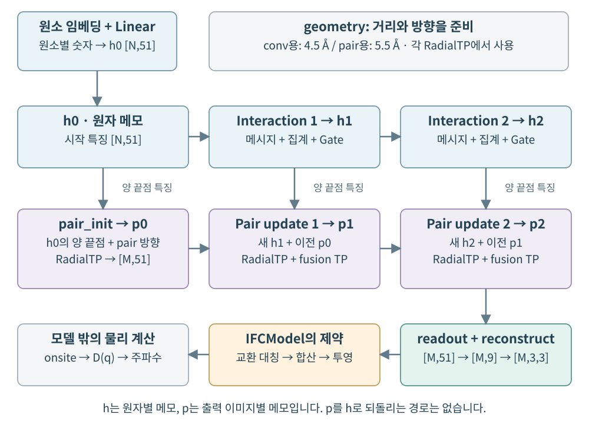
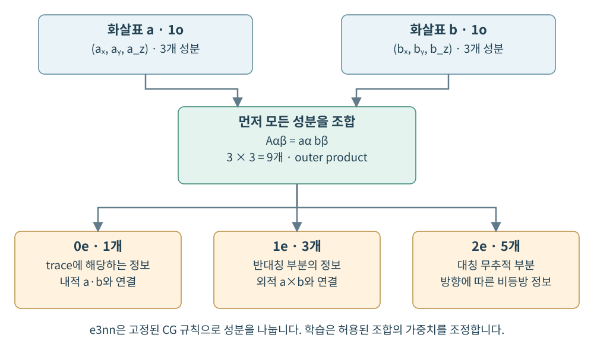
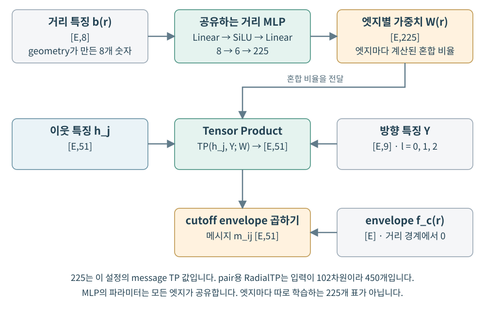
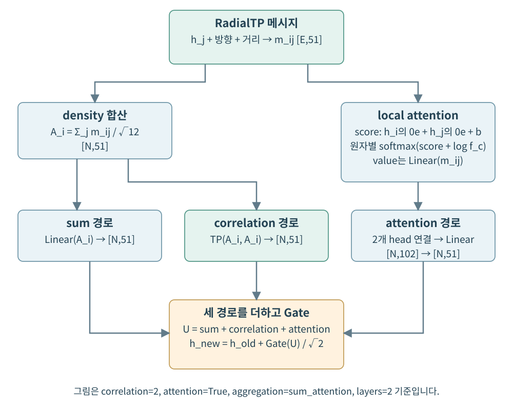
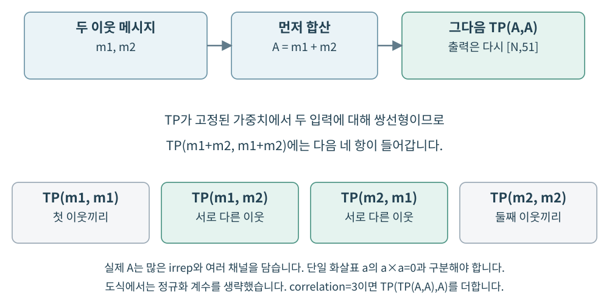
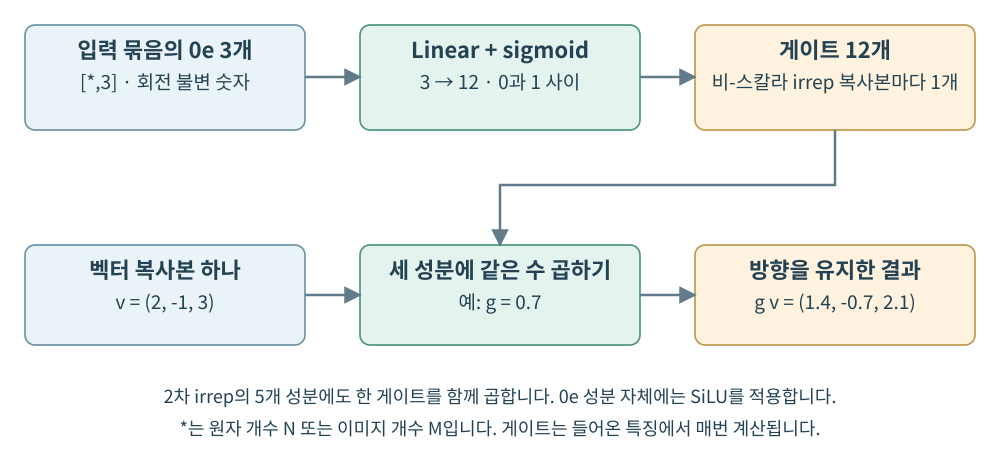
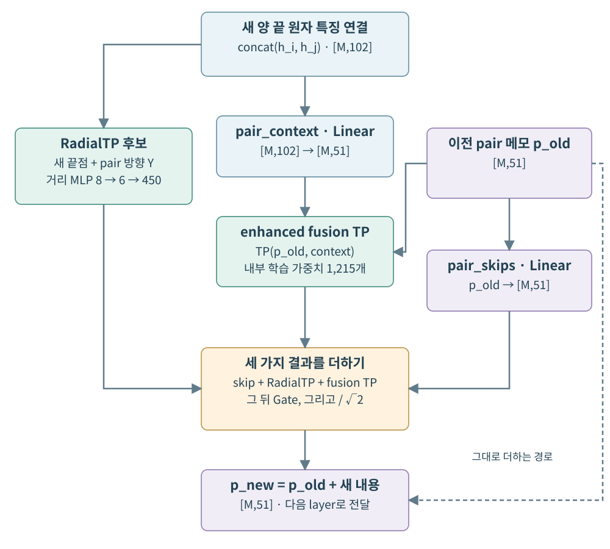
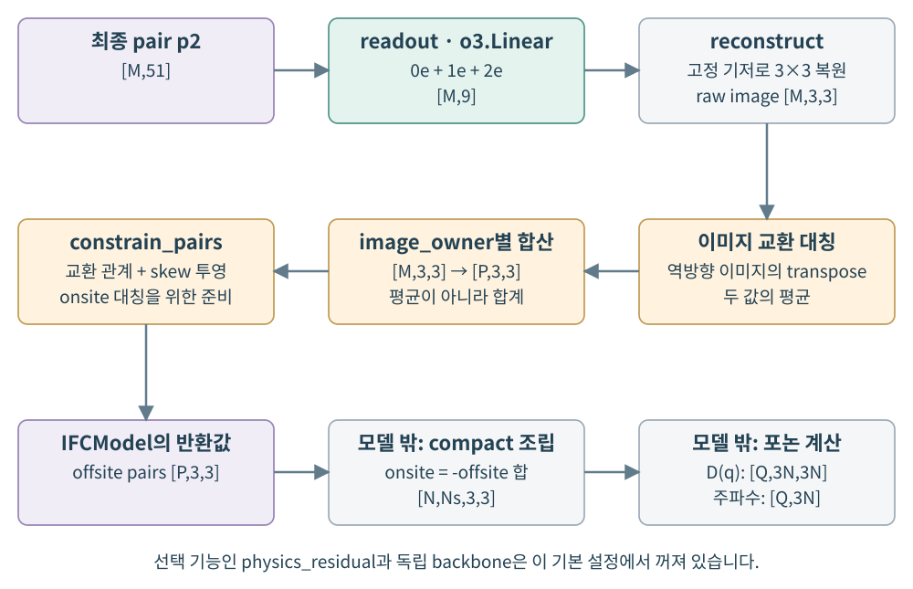

# 그림으로 따라가는 모델 구조와 Tensor Product

**원자들의 메모가 어떻게 3×3 힘 상수 표가 되는지, 실제 코드 순서대로 읽기**

[공과 용수철 설명서](BEGINNER_GUIDE_KO.md)에서는 “원자 하나를 조금 움직이면 이웃이 어떻게 반응할까?”에서 출발했습니다. 이번에는 그 반응표인 IFC를 만드는 신경망 안으로 들어가 봅니다.

원자는 **자기 주변을 설명하는 메모**를 가지고, 원자 쌍은 **둘 사이의 관계를 설명하는 메모**를 가집니다. 모델은 이 메모들을 반복해서 고친 뒤 3×3 힘 상수 표로 바꿉니다. Tensor Product는 메모 속 방향 정보를 올바른 규칙으로 결합하는 중요한 도구입니다.

처음에는 그림과 각 장의 설명만 읽어도 됩니다. 코드 상자와 수식은 그 이야기가 실제로 어떻게 구현되는지 확인하는 두 번째 길입니다.

> **이 문서의 기준**
>
> 검토한 코드는 [커밋 `f1bb16a`](https://github.com/donghoonst/phononh_gnn/commit/f1bb16a56cb9e4682a2018187a33c47cb1bebda7)의 `ifc2/model.py`이며, 그림은 `configs/small.yaml` 설정을 따릅니다. 학습된 물질 성능을 새로 주장하는 문서가 아니라, 실제 구조와 계산을 설명하는 문서입니다. 텐서 크기는 같은 설정의 미학습 모델을 직접 실행해 확인했습니다.

## 읽는 지도

| 읽을 곳 | 따라갈 이야기 |
|---|---|
| 1–3장 | 전체 모델, 원자 메모, 거리와 방향 준비 |
| 4–5장 | Tensor Product가 무엇이며 RadialTP에서 어떻게 쓰이는지 |
| 6–8장 | 원자 메모 갱신: 합산, attention, correlation, gate |
| 9–10장 | 원자 쌍 메모 갱신과 최종 힘 상수 출력 |
| 11–13장 | TP 사용 위치 전체 지도, 설정 차이, 직접 실행하기 |
| 부록 A–C | 수식, 코드 위치, 자주 생기는 오해 |

## 1. 전체 모델에는 두 줄의 메모가 흐릅니다

공과 용수철로 만든 작은 마을을 떠올려 봅시다. 공 하나가 자기 이웃의 특징을 알아야 하고, 두 공 사이의 연결도 그 둘의 환경을 알아야 합니다.

이 모델은 그 두 종류의 정보를 따로 저장합니다.

- `h`: 원자별 메모. “내 주변에는 어떤 원자들이 어떻게 놓여 있을까?”
- `p`: 출력할 주기적 이미지별 원자 쌍 메모. “이 두 원자 사이의 관계는 어떨까?”



그림을 왼쪽에서 오른쪽으로 읽어 봅시다.

1. 원소 번호를 숫자 특징으로 바꾸어 첫 원자 메모 `h0`를 만듭니다.
2. `h0`의 양 끝점 정보와 pair 방향으로 첫 관계 메모 `p0`를 만듭니다.
3. 첫 `Interaction`이 이웃 정보를 모아 `h0`를 `h1`으로 고칩니다.
4. 새 `h1`과 기존 `p0`를 사용해 관계 메모를 `p1`으로 고칩니다.
5. 같은 순서로 `h2`, `p2`를 만듭니다.
6. 최종 `p2`를 9개 계수로 읽고 3×3 표로 복원합니다.
7. 물리 제약과 compact 조립을 거쳐 포논 계산으로 연결합니다.

원자 메모와 pair 메모를 한꺼번에 뒤섞는 구조가 아닙니다. **한 layer 안에서 원자 메모를 먼저 고치고, 그 결과로 pair 메모를 고칩니다.** 현재 코드에는 pair 메모를 다시 원자 메시지로 되돌리는 경로가 없습니다.

그림의 기준 설정은 다음과 같습니다.

| 설정 | 값 | 쉬운 뜻 |
|---|---:|---|
| `width` | 3 | 각 irrep 종류의 특징 복사본 수 |
| `layers` | 2 | 원자·pair 갱신을 반복하는 횟수 |
| `lmax` | 2 | 사용하는 방향 표현의 최대 angular order |
| `num_rbf` | 8 | 거리를 표현하는 숫자 개수 |
| `correlation` | 2 | 모은 특징끼리 2차 곱 결합 사용 |
| `attention_heads` | 2 | 두 가지 가중 집계 경로 사용 |
| `persistent_pair` | `True` | pair 메모를 layer 사이에 유지 |
| `enhanced_fusion` | `True` | 기존 pair와 새 원자 환경의 TP 사용 |
| `independent_heads` | `False` | 한 backbone에서 대칭·반대칭 성분 출력 |
| `physics_residual` | `False` | 추가 결합 강성 항은 사용하지 않음 |

`ModelConfig()`를 인자 없이 만드는 설정과는 일부 값이 다릅니다. 특히 이 문서는 `width=3`, `enhanced_fusion=True`인 **작은 실습 설정**을 설명합니다.

## 2. 메모는 글자가 아니라 종류가 다른 숫자 묶음입니다

원자에게 붙인 메모는 문장이 아니라 숫자 배열입니다. 그런데 숫자라고 모두 같은 종류는 아닙니다.

예를 들어 온도는 지도를 돌려도 그대로지만, 동쪽을 가리키는 화살표는 지도와 함께 돌아야 합니다. 그래서 방향 없는 숫자와 방향 있는 숫자를 구분해 다룹니다.

이런 **회전·반전 변환의 종류**를 나타내는 말이 irrep입니다. 처음에는 “같은 방식으로 돌아가는 특징의 묶음”이라고 이해하면 됩니다.

### 2.1 현재 hidden 메모는 왜 51칸일까요

`width=3`, `lmax=2`일 때 코드의 hidden representation은 다음과 같습니다.

```text
3x0e + 3x1o + 3x1e + 3x2o + 3x2e
```

| 종류 | 복사본 하나의 성분 수 | 복사본 수 | 차지하는 칸 |
|---|---:|---:|---:|
| `0e` | 1 | 3 | 3 |
| `1o` | 3 | 3 | 9 |
| `1e` | 3 | 3 | 9 |
| `2o` | 5 | 3 | 15 |
| `2e` | 5 | 3 | 15 |
| 합계 | | | **51** |

`1o`는 일반적인 위치·변위 화살표와 같은 변환을 하고, `1e`는 두 화살표의 벡터 외적과 같은 축벡터 변환을 합니다. `e/o`는 반전에 대한 성질을 구분합니다. 방향을 바꾸어 보는 것까지 올바르게 다루기 위해 이 구분이 필요합니다.

이 숫자들은 원자에 실제로 작용하는 힘 그 자체가 아닙니다. 모델이 예측에 사용하도록 학습한 중간 특징입니다.

### 2.2 시작할 때는 원소 이름표만 있습니다

```python
h = self.embed(self.embedding(s["z"]))
```

작은 예시에서는 다음 순서가 됩니다.

```text
원자 번호 z [3]
    → Embedding [3,3]
    → o3.Linear [3,51]
```

첫 번째 3은 원자가 세 개라는 뜻이고, 뒤의 숫자는 원자 하나의 특징 칸 수입니다.

원소 번호만으로 특정 방향을 만들어 낼 수는 없습니다. 따라서 초기에는 `0e` 스칼라에서 시작하고, 다른 종류의 방향 특징은 0입니다. 이후 이웃의 상대 방향과 결합하면서 방향 정보가 생깁니다.

### 2.3 그림의 N, E, M, P는 서로 다릅니다

| 기호 | 뜻 | 이번 예시 |
|---|---|---:|
| `N` | primitive 원자 수 | 3 |
| `E` | convolution용 방향성 이웃 이미지 수 | 26 |
| `M` | IFC를 출력할 shortest image 수 | 60 |
| `P` | 이미지를 묶은 compact offsite 그룹 수 | 51 |
| `d` | hidden 메모의 칸 수 | 51 |

여기서 `P=51`과 `d=51`은 우연히 같은 숫자입니다. 앞의 51은 구조에서 정해진 그룹 개수이고, 뒤의 51은 모델 설정에서 정해진 특징 차원입니다. 다른 구조를 넣으면 `P`는 바뀔 수 있지만 같은 설정의 `d`는 그대로입니다.

## 3. 이웃 소식을 듣기 전에 거리와 방향을 준비합니다

친구가 “저쪽에 있다”는 말만 보내면 부족합니다. 얼마나 멀리 있는지와 어느 방향인지가 함께 필요합니다.

`geometry()`는 상대 벡터를 세 종류의 입력으로 바꿉니다.

| 결과 | 역할 | convolution 예시 shape |
|---|---|---|
| `radial` | 거리를 8개의 숫자로 표현 | `[26,8]` |
| `sh` | 방향을 구면조화함수로 표현 | `[26,9]` |
| `envelope` | cutoff 경계에서 값을 0으로 줄이는 계수 | `[26]` |

### 거리 하나를 왜 여덟 숫자로 바꿀까요

거리 하나로부터 모양이 다른 8개의 함숫값을 만듭니다. 한 자로만 재는 대신 모양이 다른 눈금 여러 개로 같은 거리를 읽는다고 생각하면 됩니다. 뒤의 작은 신경망은 이 숫자들을 조합해 거리 의존성을 학습합니다.

현재 코드는 `sinc` 함수를 사용하는 radial basis를 씁니다. 함수 모양은 정해져 있고, 그 뒤의 MLP 가중치가 학습됩니다.

### 방향의 9칸은 최종 IFC의 9칸과 다릅니다

`lmax=2`이면 방향 특징은 `l=0,1,2`에서 1 + 3 + 5 = 9개입니다.

```text
방향 특징 Y : 0e + 1o + 2e
최종 IFC    : 0e + 1e + 2e
```

둘 다 9차원이지만 가운데 성분의 변환법이 다릅니다. 구면조화함수의 `1o`는 상대 방향에 해당하고, IFC의 `1e`는 3×3 표의 반대칭 부분에 해당합니다.

### 같은 함수로 두 종류의 geometry를 계산합니다

원자 메모를 갱신할 convolution 그래프에는 `conv_cutoff=4.5 Å`를 씁니다. 출력할 pair 이미지에는 `pair_cutoff=5.5 Å`를 씁니다. 하나는 “누구의 소식을 들을까”, 다른 하나는 “누구 사이의 표를 만들까”의 범위입니다.

신경망의 메시지와 pair 초기·기하 갱신에는 부드러운 envelope를 적용합니다. 다만 후단의 현재 물리 제약 투영까지 포함한 최종 IFC가 cutoff에서 항상 연속적이라는 뜻은 아닙니다. 그 별도 문제는 기존 입문 설명서의 11장에 정리되어 있습니다.

## 4. Tensor Product는 두 종류의 정보를 규칙에 맞게 조합합니다

`Tensor Product`는 텐서곱입니다. “두 입력을 함께 사용해 새 특징을 만들되, 회전했을 때의 규칙을 지킨다”가 여기에서의 핵심입니다.

먼저 일반적인 두 화살표를 생각해 봅시다. 화살표 `a`에 x·y·z 성분이 세 개 있고, `b`에도 세 개가 있습니다. 모든 성분끼리 조합하면 3 × 3 = 9개의 곱이 만들어집니다.



### 4.1 이어 붙이기와 곱으로 결합하기는 다릅니다

`concat(a,b)`는 두 메모를 나란히 놓는 것입니다. 3칸과 3칸을 이어 붙이면 6칸입니다. 이 연산 자체가 두 입력 사이의 곱 관계를 만들지는 않습니다.

바깥곱 `a ⊗ b`는 a의 각 성분과 b의 각 성분을 곱합니다. 9개의 조합이 생깁니다.

성분별 곱 `a * b`는 같은 위치의 성분만 곱합니다. 일반적인 Cartesian 벡터에서 이것을 그대로 벡터 출력처럼 취급하면, 필요한 회전 규칙을 자동으로 만족하지 않습니다.

이 프로젝트의 e3nn Tensor Product는 **허용된 변환 종류로 곱을 결합하고, 출력 종류별로 모으는 연산**입니다. 단순히 `torch.cat`이나 `a * b`의 다른 이름이 아닙니다.

### 4.2 오른쪽 화살표와 위쪽 화살표로 해 봅시다

```text
a = (1, 0, 0)
b = (0, 1, 0)

A = a ⊗ b = [[0, 1, 0],
             [0, 0, 0],
             [0, 0, 0]]
```

이 3×3 표를 세 부분으로 나눕니다.

```text
등방 부분       = [[0, 0,   0],
                  [0, 0,   0],
                  [0, 0,   0]]

반대칭 부분     = [[0,  0.5, 0],
                  [-0.5, 0, 0],
                  [0,    0, 0]]

대칭 무추적 부분 = [[0, 0.5, 0],
                   [0.5, 0, 0],
                   [0,   0, 0]]
```

세 부분을 더하면 처음 표 A가 됩니다. 일반적인 3×3 표에서 각 부분의 독립적인 성분 수는 1, 3, 5입니다. 이 변환 관계가 다음 식입니다.

$$
1o\otimes1o=0e\oplus1e\oplus2e
$$

내적 `a·b`는 방향 없는 스칼라와 연결되고, 벡터 외적 `a×b`는 축벡터와 연결됩니다. 나머지 대칭 무추적 부분은 방향별 차이를 담습니다. e3nn 출력의 정확한 계수 부호·순서·크기는 기저와 정규화 convention을 따르므로, 그대로 내적·외적 숫자와 같다고 가정하면 안 됩니다.

### 4.3 Clebsch–Gordan은 분류 규칙이고, 가중치는 배우는 숫자입니다

곱에서 나온 성분을 어떤 회전 종류로 묶을지는 수학적으로 정해집니다. 그 결합 규칙을 **Clebsch–Gordan(CG) 계수**라고 합니다.

이 규칙을 모델이 매번 새로 발명하는 것은 아닙니다. 모델은 허용된 결합들 가운데 어떤 것을 얼마나 사용할지 학습합니다.

예를 들어 똑같이 회전하는 벡터 특징이 세 복사본 있다면, 그중 어느 복사본의 조합을 더 중요하게 사용할지는 학습 가능한 가중치로 조절할 수 있습니다. 방향 변환법을 유지하면서도 다양한 함수를 배울 수 있는 이유입니다.

`FullyConnectedTensorProduct`의 “FullyConnected”도 **허용된 irrep·채널 결합을 연결한다**는 뜻입니다. 모든 원자를 거리와 무관하게 전부 연결한다는 뜻은 아닙니다. 원자 연결 범위는 여전히 앞에서 만든 그래프가 정합니다.

## 5. RadialTP는 거리에 따라 조합 비율을 바꿉니다

Tensor Product를 실제 메시지에 쓰려면 이웃 특징과 방향을 결합해야 합니다. 가까운 이웃과 먼 이웃에 다른 가중치를 주는 기능도 필요합니다.

이를 맡는 작은 모듈이 `RadialTP`입니다.



그림의 세 입력을 나누어 읽어 봅시다.

1. `h_j`: 이웃 원자 j가 가진 특징입니다.
2. `Y`: 중심 원자 i에서 그 이웃을 향하는 방향 특징입니다.
3. `W(r)`: 거리에 따라 정한 결합 가중치입니다.

코드의 중심은 다음 한 줄입니다.

```python
self.tp(x, sh, self.radial(radial)) * envelope[:, None]
```

여기서 `self.radial`은 작은 MLP입니다. “거리 특징을 읽어 Tensor Product에 필요한 가중치를 만든다”가 역할입니다.

### 5.1 실제로 지나간 크기

현재 message용 `RadialTP`에서는 다음 크기를 확인했습니다.

```text
거리 특징             [26,8]
    → MLP: 8 → 6 → 225
엣지별 TP 가중치      [26,225]

이웃 특징             [26,51]
방향 특징             [26,9]
    → Tensor Product
메시지                 [26,51]
```

225는 이 irrep 구성에서 TP가 요구하는 가중치 수입니다. 숨겨진 특징 차원 51과 같은 뜻이 아닙니다. 출력 이미지용 pair RadialTP는 양 끝점을 이어 붙인 102차원 특징을 받으므로 가중치 수가 450입니다.

### 5.2 엣지별 가중치와 엣지별 학습 파라미터는 다릅니다

MLP는 모든 엣지가 공유하는 하나의 함수입니다. 각 엣지가 자기 거리 특징을 이 함수에 넣어 다른 가중치를 얻습니다.

즉, 엣지 26개에 대해 225개씩의 독립적인 학습 표를 저장해 두는 방식이 아닙니다. 같은 layer에서 같은 거리 특징을 넣으면 같은 TP 가중치가 계산됩니다. 이웃 특징과 방향이 다르면 메시지는 달라질 수 있습니다.

```python
self.tp = o3.FullyConnectedTensorProduct(
    ir, sh, out, shared_weights=False
)
```

이 설정에서는 TP 밖의 MLP가 엣지별 가중치를 공급합니다. “가중치를 공유하지 않는다”는 이 옵션을 “MLP도 엣지마다 따로 만든다”로 읽으면 안 됩니다.

### 5.3 방향 정보는 여기서 생기고 바뀝니다

처음에는 원소를 나타내는 `0e` 스칼라만 있어도, 이를 방향 특징 `1o`와 결합하면 `1o` 특징을 만들 수 있습니다. 스칼라가 화살표의 크기를 조절하는 가장 간단한 예입니다.

이후에는 이미 방향을 가진 hidden 특징과 다른 방향 특징을 다시 결합하면서 더 풍부한 표현을 만듭니다. 다만 출력 irrep 목록에 없는 종류까지 무한히 저장하는 것은 아닙니다. 현재 hidden 공간 안에 허용된 출력 경로만 유지합니다.

## 6. Interaction은 이웃 소식을 세 경로로 정리합니다

메시지를 만들었으니 이제 원자별로 모아야 합니다. 이것을 수행하는 큰 블록이 `Interaction`입니다.



그림은 `correlation=2`, attention 사용, 기본 `sum_attention` 설정입니다.

### 6.1 첫 번째 경로: 소식을 합합니다

```python
m = self.message(h[j], sh, radial, envelope)
density = scatter(m, i, n) / math.sqrt(12.0)
update = self.mix(density)
```

메시지의 방향은 `j → i`입니다. `scatter`는 같은 수신 원자 i로 들어온 메시지를 더합니다.

```text
모든 엣지의 메시지 [E,51]
    → 수신 원자별 합산
원자별 density A [N,51]
```

여기에서 `density`는 학습된 메시지의 합을 가리키는 변수 이름입니다. DFT의 전자 밀도 자체를 뜻하지 않습니다.

나누는 값 `√12`는 고정 상수입니다. 원자마다 실제 이웃 수를 세어서 나누는 평균 연산이 아닙니다. 뒤의 `o3.Linear`는 같은 종류의 irrep 복사본을 섞습니다.

### 6.2 두 번째 경로: 상황에 따라 더 집중해서 듣습니다

어떤 이웃의 소식을 더 중요하게 볼지 attention 점수를 만듭니다.

현재 점수의 재료는 다음과 같습니다.

```text
중심 원자의 0e 특징 3개
+ 이웃 원자의 0e 특징 3개
+ 거리 특징 8개
= 엣지마다 14개 숫자

MLP: 14 → 3 → 2
    → head 두 개의 점수
```

이 점수들은 방향 없는 스칼라이므로 좌표계를 돌려도 같은 방식으로 비교할 수 있습니다.

각 수신 원자의 이웃들 안에서 `softmax(score + log(envelope))`를 계산합니다. 모든 원자를 한꺼번에 모아 정규화하는 것은 아닙니다. cutoff 밖의 엣지는 점수 계산 전에 제외합니다.

각 head는 `o3.Linear(m)`로 바꾼 메시지를 가중 합산합니다. 두 head의 결과를 이어 붙이면 `[N,102]`, 이를 다시 `o3.Linear`로 바꾸면 `[N,51]`입니다.

attention의 score MLP와 value Linear 자체는 새로운 Tensor Product 호출이 아닙니다. **앞에서 TP로 만든 메시지를 어떻게 가중해서 모을지 결정하는 경로**입니다.

### 6.3 세 번째 경로: 모인 정보끼리 결합합니다

합산한 density A끼리 다시 Tensor Product를 합니다. “이웃들이 각각 무엇을 말했는가”를 넘어서, 모인 특징 사이의 곱 관계를 만들려는 경로입니다.

이 부분이 `correlation`입니다. 바로 다음 장에서 확대해 보겠습니다.

### 6.4 세 경로 뒤에는 같은 크기의 메모가 나옵니다

세 경로의 결과는 모두 `[N,51]`이므로 더할 수 있습니다. 이를 Gate에 통과시키고, `√layers`로 나눈 뒤 기존 원자 메모에 더합니다.

```text
기존 h [N,51]
    + Gate(sum + attention + correlation) / √2
    = 새 h [N,51]
```

이것이 residual update입니다. 기존 메모를 버리고 처음부터 다시 쓰기보다, 기존 메모에 새 정보를 더하는 방식입니다.

## 7. Correlation TP는 서로 다른 이웃 사이의 곱도 담습니다

두 이웃이 각각 `m1`, `m2`라는 메시지를 보냈다고 해 봅시다. 둘을 더해 `A = m1 + m2`를 만든 뒤 `TP(A,A)`를 계산합니다.



고정된 가중치에서 TP는 두 입력 각각에 대해 선형입니다. 그래서 합을 곱하면 서로 다른 이웃의 조합도 나타납니다.

$$
\operatorname{TP}(m_1+m_2,m_1+m_2)
=\operatorname{TP}(m_1,m_1)+\operatorname{TP}(m_1,m_2)
+\operatorname{TP}(m_2,m_1)+\operatorname{TP}(m_2,m_2)
$$

그림과 식에서는 설명을 위해 합산 정규화 계수를 생략했습니다.

이런 방식은 모든 이웃 쌍을 Python 반복문으로 직접 나열하지 않고도 교차항을 포함하게 합니다. 다만 서로 다른 이웃만을 골라 세는 연산은 아닙니다. 자기 자신과의 조합도 포함됩니다.

### 7.1 실제 코드와 shape

```python
product = density
for tp in self.products:
    product = tp(product, density)
    update = update + product
```

`correlation=2`이면 한 번 계산합니다.

```text
TP(A, A)
[N,51] × [N,51] → [N,51]
```

`correlation=3`이면 두 단계가 됩니다.

```text
B2 = TP2(A, A)
B3 = TP3(B2, A)
update에 B2와 B3를 모두 추가
```

`TP2`, `TP3`는 서로 다른 학습 모듈입니다. 같은 한 모듈을 가중치까지 공유해 반복 호출하는 것이 아닙니다.

### 7.2 여기서는 가중치를 TP 안에 저장합니다

이 모듈은 `FullyConnectedTensorProduct(ir, ir, ir)`로 생성합니다. RadialTP와 달리 외부 거리 MLP가 가중치를 전달하지 않습니다.

현재 설정에서 correlation TP 하나의 내부 학습 가중치는 1,215개입니다. 같은 layer의 모든 원자에 이 가중치를 공유하며, 각 원자의 A가 다르기 때문에 출력은 달라집니다.

### 7.3 “자기 자신을 곱하니 방향 정보가 다 사라질까?”

벡터 하나의 `a×a`는 0입니다. 하지만 A는 화살표 하나가 아니라 여러 irrep와 여러 특징 복사본을 담은 51차원 묶음입니다. 서로 다른 복사본 사이의 결합도 있기 때문에 `TP(A,A)` 전체가 0이라고 판단하면 안 됩니다.

또한 이 방식은 MACE의 완전한 대칭 다체 기저와 같지 않습니다. 매 단계 현재 hidden irrep 공간으로 투영하는 재귀적 곱입니다. `correlation=3`이라는 설정만 보고 모델 전체의 정확한 원자 body order를 단정할 수도 없습니다.

## 8. Gate는 화살표를 찌그러뜨리지 않고 크기를 조절합니다

화살표의 x 성분만 두 배로 늘리고 y 성분은 그대로 두면 방향이 달라집니다. 좌표계를 돌렸을 때도 같은 규칙으로 작동해야 하는 신경망에서는 이런 연산을 조심해야 합니다.

현재 Gate는 방향 없는 스칼라에서 가중치를 만든 뒤, irrep 한 복사본의 모든 성분에 같은 가중치를 곱합니다.



예를 들어 `v=(2,-1,3)`에 게이트 `g=0.7`을 적용하면 다음과 같습니다.

```text
g v = (1.4, -0.7, 2.1)
```

방향은 유지하고 크기만 바뀝니다. 2차 irrep의 다섯 성분에도 한 복사본 안에서는 같은 게이트를 곱합니다.

### 게이트는 왜 12개일까요

hidden에는 `1o`, `1e`, `2o`, `2e` 네 종류가 각각 세 복사본 있습니다. 따라서 비스칼라 irrep 복사본은 4 × 3 = 12개이고, 게이트도 12개입니다.

```text
들어온 묶음의 0e 성분 [*,3]
    → Linear(3,12)
    → sigmoid
게이트                 [*,12]
```

`*`는 원자 Gate에서는 N, pair Gate에서는 M입니다. Gate에 들어온 현재 특징에서 매번 계산합니다. 처음 원소 임베딩에 고정된 숫자가 아닙니다.

`0e` 성분 자체에는 SiLU를 적용합니다. 비스칼라 성분은 위 방식으로 스칼라 게이트를 곱합니다. 이 모듈에는 학습 MLP가 있지만, 별도의 `FullyConnectedTensorProduct` 호출은 없습니다.

게이트 개수 12와 메시지 합산의 정규화 상수 `√12`는 서로 다른 이유로 등장한 숫자입니다.

## 9. Pair 갱신은 새 원자 환경과 이전 관계를 함께 읽습니다

원자 메모만 있으면 “각 원자 주변이 어떤가”를 알 수 있습니다. 그러나 출력은 두 원자 사이의 힘 상수입니다. 그래서 이 모델은 출력 이미지별로 pair 메모를 유지합니다.

`image_owner`를 사용해 해당 이미지의 양 끝 원자 특징을 가져옵니다. 같은 원자 쌍이어도 주기적 이동이 다르면 상대 방향이 달라질 수 있습니다.

### 9.1 첫 pair 메모

```python
pair = self.pair_init(
    torch.cat([h[i], h[j]], -1), pg[1], pg[0], pg[2]
)
```

`pg`는 pair geometry이며 `pg[1]`은 방향, `pg[0]`은 radial, `pg[2]`는 envelope입니다.

```text
양 끝 원자 특징 [M,51] + [M,51]
    → 이어 붙이기 [M,102]
    → pair 방향·거리와 RadialTP
첫 pair p0 [M,51]
```

이 초기화는 첫 node Interaction보다 먼저 실행합니다. 따라서 초기 h0의 원소 정보와 pair 방향을 사용합니다.

### 9.2 한 layer에서 pair를 고치는 정확한 순서



새 원자 메모 `h_new`를 얻은 뒤 세 재료를 만듭니다.

**첫 재료: 새 원자 환경과 pair 방향으로 만든 후보**

`pair_updates[layer]`라는 RadialTP를 사용합니다. 양 끝점 102차원과 pair 방향 9차원을 결합하고, 8차원 radial에서 450개의 가중치를 만듭니다. 결과는 `[M,51]`입니다.

**둘째 재료: 기존 관계 메모와 새 환경의 곱**

새 양 끝점 특징을 `pair_context`라는 `o3.Linear`로 102차원에서 51차원으로 바꿉니다. 그다음 기존 pair와 결합합니다.

```python
self.pair_products[layer](
    pair,
    self.pair_context(torch.cat([h[i], h[j]], -1))
)
```

이것이 **enhanced fusion**입니다. “예전 관계를 알고 있을 때 새 환경 정보를 어떻게 반영할까?”를 곱 형태로 표현합니다.

```text
이전 pair p_old [M,51]
새 원자 context [M,51]
    → 내부 가중치가 있는 TP
fusion 결과 [M,51]
```

이 TP도 내부 가중치 1,215개를 가지며 같은 layer의 모든 출력 이미지에서 공유합니다. `pair_context` Linear는 pair layer들 사이에 하나를 공유하지만, `pair_products[layer]`의 TP는 layer마다 따로 있습니다.

**셋째 재료: 기존 메모의 선형 변환**

`pair_skips[layer](pair)`가 기존 pair를 `o3.Linear`로 바꿉니다. 크기는 `[M,51]` 그대로입니다.

세 재료를 더해 Gate와 크기 조절을 거친 다음, 원래 pair 자체도 다시 더합니다.

```text
p_new = p_old
      + Gate(Linear(p_old) + RadialTP + fusion_TP) / √2
```

여기에는 기존 pair가 두 방식으로 들어갑니다. 하나는 Gate 안의 선형 변환 경로이고, 하나는 바깥에서 그대로 더하는 residual 경로입니다. 둘을 같은 한 화살표로 생략하면 실제 구조를 놓치게 됩니다.

또한 fusion을 끈 모델에도 기본 persistent pair 갱신은 남습니다. “enhanced fusion이 있어야 처음 pair 메모가 생긴다”는 해석은 맞지 않습니다.

## 10. 마지막에는 51칸 메모를 3×3 표로 읽습니다

이제 최종 pair 특징을 실제 IFC 형태로 바꿉니다.



### 10.1 readout은 새로운 TP가 아닙니다

```python
self.readout = o3.Linear(self.ir, "0e+1e+2e")
```

여러 복사본으로 저장된 hidden 특징을 출력에 필요한 종류별 한 복사본으로 읽습니다.

```text
pair [M,51] → readout → coefficient [M,9]
```

`o3.Linear`는 같은 `(l, parity)` 종류끼리만 섞습니다. 벡터를 스칼라와 마음대로 더해 다른 회전 종류를 만드는 연산이 아닙니다. 새 종류를 만들어 내는 데 TP가 중요한 이유이기도 합니다.

### 10.2 reconstruct는 고정된 변환입니다

```python
images = reconstruct(self.readout(pair))
```

9개 계수를 정해진 기저에 따라 다시 3×3 Cartesian 표로 바꿉니다. `[M,9] → [M,3,3]`이며, 이 변환에 새 학습 가중치는 없습니다.

### 10.3 raw image를 물리적으로 정리합니다

현재 `IFCModel.forward`의 순서는 다음과 같습니다.

1. 역방향 이미지의 transpose와 평균을 내어 교환 관계를 맞춥니다.
2. `image_owner`가 같은 이미지들을 **합산**하여 compact 그룹으로 만듭니다.
3. `constrain_pairs`로 그룹의 교환 관계와 반대칭 행합을 정리합니다.
4. `[P,3,3]` 크기의 offsite pair IFC를 반환합니다.

`compact_from_pairs`는 모델 바깥에서 onsite를 추가합니다. onsite를 offsite 합의 음수로 정해 ASR을 맞춥니다. 그다음 질량과 위상을 넣어 동역학 행렬을 만들고 주파수를 계산합니다.

이번 예시의 실제 출력 크기는 다음과 같습니다.

```text
raw / 보정된 image IFC       [60,3,3]
compact offsite pairs        [51,3,3]
onsite 포함 compact IFC      [3,24,3,3]
q-point 한 개의 D(q)         [1,9,9]
```

선택적으로 반환하는 이미지별 IFC는 compact 합계가 맞도록 보정된 분배입니다. compact 정답만으로 이미지별 분배가 유일해지지는 않습니다. 이미지별 값을 직접 Fourier 변환하는 것과 현재 compact phase-average 계산은 구분해야 합니다.

## 11. Tensor Product가 사용되는 곳을 한 장에 모아 봅시다

지금까지 TP가 나올 때마다 “무엇과 무엇을 결합하는가”를 물었습니다. 이를 모으면 전체 모델이 훨씬 선명해집니다.

| 사용 위치 | 입력 두 가지 | 얻는 정보 |
|---|---|---|
| node message | 이웃 원자 특징 × 이웃 방향 | 방향을 반영한 메시지 |
| node correlation | 모인 density × 모인 density | 이웃 특징들의 곱 상관 |
| pair 초기화 | 양 끝 원자 특징 × pair 방향 | 첫 관계 메모 |
| pair 기하 갱신 | 새 양 끝 특징 × pair 방향 | 새 환경의 기하 후보 |
| enhanced pair fusion | 이전 pair × 새 원자 context | 기존 관계와 새 환경의 곱 상관 |

거리 가중치의 출처도 두 종류입니다.

| 모듈 | 가중치의 출처 | 작은 설정의 TP 가중치 개수 |
|---|---|---:|
| message RadialTP | 거리 MLP가 엣지별 계산 | 225 |
| pair 초기화·기하 RadialTP | 거리 MLP가 이미지별 계산 | 450 |
| node correlation TP | TP 내부의 학습 파라미터 | 1,215 |
| enhanced fusion TP | TP 내부의 학습 파라미터 | 1,215 |

225와 450은 MLP가 내놓는 가중치 벡터의 길이입니다. 이 표의 숫자를 모두 더해 모델 파라미터 수라고 하면 안 됩니다. 예를 들어 message의 거리 MLP `8 → 6 → 225`에는 bias까지 포함해 1,629개의 학습 파라미터가 있습니다. TP가 요구하는 가중치 225개와 다른 수입니다.

### 한 forward에서 TP 모듈은 몇 번 호출될까요

그림의 작은 설정에서는 다음과 같습니다.

| 호출 종류 | 횟수 |
|---|---:|
| pair 초기화 | 1 |
| node message | 2 layers × 1 = 2 |
| node correlation | 2 layers × 1 = 2 |
| pair 기하 갱신 | 2 layers × 1 = 2 |
| enhanced pair fusion | 2 layers × 1 = 2 |
| 합계 | **9** |

한 모듈 호출 안에서 여러 원자나 엣지를 한꺼번에 계산합니다. 원자 쌍이 아홉 개라는 뜻이 아닙니다. `correlation`, `layers`, fusion, 독립 backbone 설정을 바꾸면 호출 수도 달라집니다.

선택한 작은 공유 backbone 모델의 전체 학습 파라미터는 **19,033개**입니다. 이번 실행에서도 확인한 값입니다.

## 12. 설정을 바꾸면 어느 그림이 달라질까요

모든 스위치가 새로운 전체 모델을 뜻하지는 않습니다. 어느 경로를 켜고 끄는지 연결해서 읽으면 됩니다.

| 설정 변경 | 실제 달라지는 부분 |
|---|---|
| `correlation=1` | density 곱 경로가 없어짐 |
| `correlation=3` | `TP(B2,A)` 단계가 하나 더 생김 |
| `attention=False` | attention 경로가 없어짐 |
| `aggregation="attention_only"` | attention을 켠 경우, 선형 sum 경로 대신 attention을 기본 update로 사용 |
| `enhanced_fusion=False` | pair 그림의 `TP(p_old,context)`가 없어짐 |
| `persistent_pair=False` | 매 layer pair 갱신 대신 마지막에 별도 갱신 |
| `independent_heads=True` | 전체 backbone 두 개로 대칭·반대칭 성분을 각각 계산 |
| `physics_residual=True` | 이미지 IFC에 결합 방향 강성 항을 추가 |

`attention_only`여도 `correlation>1`이면 density를 사용하는 곱 경로는 남습니다. 모든 sum 정보가 제거된 모델이라고 설명하면 안 됩니다.

또한 검토한 버전에서는 `persistent_pair=False`와 `enhanced_fusion=True`를 함께 주면 fusion을 실제로 사용하지 않는 분기가 있습니다. 그림의 기본 설정은 persistent pair를 사용하므로 그 경우와 구분됩니다.

### 선택 기능 1: 두 backbone

`independent_heads=True`이면 한 backbone에서 대칭 부분을 취하고, 다른 backbone에서 반대칭 부분을 취해 합칩니다. 작은 Linear head 두 개만 붙이는 옵션이 아닙니다. 같은 E 설정에서는 19,033개 대신 38,066개의 파라미터를 갖습니다.

### 선택 기능 2: 결합 방향의 강성 항

`physics_residual=True`이면 작은 MLP가 두 숫자 `k_parallel`, `k_perp`를 만듭니다. 결합 방향의 강성과 그에 수직인 방향의 강성을 나타내는 형식을 빌려 다음 항을 더합니다.

$$
k_{\parallel}\,\hat r\hat r^T
+k_{\perp}\left(I-\hat r\hat r^T\right)
$$

`r̂`는 단위 결합 방향이고 `I`는 3×3 단위행렬입니다. 실제 코드에서는 이 추가 항에도 envelope를 곱합니다. `r̂r̂ᵀ`는 일반적인 바깥곱이며, 이 경로에 별도의 e3nn `FullyConnectedTensorProduct` 모듈을 쓰는 것은 아닙니다.

두 강성 숫자의 양수성을 강제하지 않으므로 이 옵션만으로 안정한 포논을 보장하지 않습니다.

### 기본적으로 lmax=2를 유지해야 하는 이유

현재 일반 IFC readout은 `2e`가 필요합니다. `lmax=1`, `physics_residual=False`이면 hidden에 `2e`가 없고, 마지막 Linear가 그것을 새로 만들 수도 없습니다. 이 버전에서 일반적인 비등방 IFC를 다루려면 기본 `lmax=2`를 유지해야 합니다.

## 13. 작은 실행으로 그림이 코드와 맞는지 확인합니다

설명에 사용한 크기는 추측한 숫자가 아닙니다. 작은 합성 geometry와 **미학습 모델**을 실행해 각 모듈을 통과하는 텐서의 shape를 기록했습니다. 학습 정확도 실험과 구분해야 합니다.

추가한 실행 예제는 [`scripts/explain_tensor_products.py`](../scripts/explain_tensor_products.py)입니다. 프로젝트와 필요한 패키지를 설치한 환경에서 저장소 루트를 기준으로 실행합니다.

```bash
python scripts/explain_tensor_products.py

# 같은 내용을 JSON으로 저장하고 싶을 때
python scripts/explain_tensor_products.py --out /tmp/model_walkthrough.json
```

예제는 다음 세 가지를 확인합니다.

1. 두 벡터의 바깥곱을 등방·반대칭·대칭 무추적 부분으로 나눈 뒤 합쳐 복원합니다.
2. 간단한 e3nn TP의 입력을 회전·반전하면 출력도 올바른 irrep 규칙으로 변환되는지 확인합니다.
3. 실제 작은 모델에 hook을 달아 각 모듈의 입력·출력 shape를 기록합니다.

회전 실습의 핵심은 다음과 같습니다. 이는 개념 설명용 `FullTensorProduct`이며, 모델이 학습하는 `FullyConnectedTensorProduct`와 구분합니다.

```python
tp = o3.FullTensorProduct("1o", "1o")
c = tp(a, b)

actual = tp(Q @ a, Q @ b)
expected = tp.irreps_out.D_from_matrix(Q) @ c
```

`Q`는 회전 또는 반전을 포함한 직교행렬입니다. `D_from_matrix(Q)`는 출력의 각 irrep에 맞는 변환 행렬입니다. 예제는 `actual`과 `expected`가 같은지 검사합니다.

이번 float64 실행에서는 회전과 반전 포함 회전 모두 최대 차이가 약 `1.76×10⁻¹⁵`였습니다. 이는 이 작은 TP 예제의 수치 검증입니다. 실제 DFT 예측 정확도를 나타내는 값은 아닙니다.

실제 모델에서 확인한 대표 경로는 다음과 같습니다.

| 모듈 | 입력 → 출력 |
|---|---|
| `embedding` | `[3] → [3,3]` |
| `embed` | `[3,3] → [3,51]` |
| `pair_init.radial` | `[60,8] → [60,450]` |
| `layers.0.message.radial` | `[26,8] → [26,225]` |
| `layers.0.message` | 특징·방향·거리·envelope → `[26,51]` |
| `layers.0.score` | `[26,14] → [26,2]` |
| `layers.0.att_mix` | `[3,102] → [3,51]` |
| `layers.0.products.0` | `[3,51]`, `[3,51]` → `[3,51]` |
| `pair_context` | `[60,102] → [60,51]` |
| `pair_products.0` | `[60,51]`, `[60,51]` → `[60,51]` |
| `readout` | `[60,51] → [60,9]` |

전체 기록은 [실행 결과 JSON](model_tensor_product_trace.json)에 있습니다. 그 안의 `module_trace`는 실제 호출 순서입니다. 숫자의 의미가 헷갈릴 때 그림과 이 기록을 나란히 보면 도움이 됩니다.

처음에는 세 질문을 따라가 보세요.

- 지금 고치는 메모는 원자 `h`인가, pair `p`인가?
- 이 TP는 무엇과 무엇을 결합하는가?
- 가중치는 거리 MLP가 만드는가, TP 안에서 학습하는가?

이 세 가지가 보이면 긴 코드도 “원자 환경을 읽고 → 관계를 고치고 → 힘 상수를 출력하는 과정”으로 이어집니다.

## 부록 A. 그림을 수식으로 옮기기

이 부록은 더 자세히 읽고 싶을 때 사용하면 됩니다. `i,j`는 원자, `e`는 convolution 엣지, `t`는 layer 단계, `a`는 attention head를 뜻합니다. `N,E,M,P`와 hidden 차원 `d`는 2장의 표와 같습니다.

### A.1 TP의 허용 결합

두 입력의 angular order를 `l₁,l₂`, parity를 `p₁,p₂`라고 하면 출력은 다음 조건을 만족하는 종류로 결합할 수 있습니다.

$$
|l_1-l_2|\le l_{\mathrm{out}}\le l_1+l_2,
\qquad p_{\mathrm{out}}=p_1p_2
$$

이 범위에 들어도 모델의 출력 irrep 목록에 없는 경로는 저장하지 않습니다. 이를 나타내는 개략식은 다음과 같습니다.

$$
z_{l m}=\sum_{l_1m_1,l_2m_2}
w_{l_1l_2l}\,C_{l_1m_1,l_2m_2}^{lm}\,
x_{l_1m_1}y_{l_2m_2}
$$

`C`는 고정 CG 계수, `w`는 학습하거나 MLP가 공급하는 가중치입니다. `m`은 irrep 내부 성분 인덱스입니다. 실제 구현에는 특징 복사본을 구분하는 채널 인덱스도 있으며, 여기서는 읽기 쉽게 생략했습니다.

### A.2 RadialTP 메시지

$$
m_{ij}^{(t)}=f_c(r_{ij})\,
\operatorname{TP}\left(h_j^{(t)},Y(\hat r_{ij});W_t(b(r_{ij}))\right)
$$

`r`은 거리, `r̂`는 방향, `f_c`는 envelope, `b`는 radial basis, `Y`는 구면조화함수, `W_t`는 해당 layer의 거리 MLP입니다. 메시지는 `[E,d]`입니다. 기본 메시지에는 `h_i`가 직접 입력되지 않으며, `h_i`는 attention score 등에 들어갑니다.

radial basis 자체에도 envelope가 들어갑니다. MLP에 비선형성과 bias가 있으므로 전체 메시지를 단순히 `f_c² × 다른 값`으로 해석할 수는 없습니다.

### A.3 Interaction

$$
A_i=\frac1{\sqrt{12}}\sum_jm_{ij},\qquad
B_i=\operatorname{TP}(A_i,A_i)
$$

$$
s_{ij}^{a}=\operatorname{MLP}_{a}
\left(h_i^{0e}\oplus h_j^{0e}\oplus b_{ij}\right),\qquad
\alpha_{ij}^{a}=\operatorname{softmax}_{j}
\left(s_{ij}^{a}+\log f_c(r_{ij})\right)
$$

$$
T_i=W_{\mathrm{att}}\left[\bigoplus_a\sum_j\alpha_{ij}^{a}V_a(m_{ij})\right]
$$

$$
h_i^{(t+1)}=h_i^{(t)}+
\frac{\operatorname{Gate}(W_{\mathrm{mix}}A_i+B_i+T_i)}{\sqrt{n_{\mathrm{layers}}}}
$$

`⊕`는 특징을 이어 붙이는 연산입니다. `W_mix`, `W_att`, `V_a`는 equivariant Linear입니다. 이 식은 `correlation=2`, `sum_attention`인 그림의 설정입니다. 원자별 각 항의 shape는 `[N,d]`입니다.

### A.4 Persistent pair update

이미지 하나의 양 끝점을 `i,j`, 이전 pair를 `p_t`, 갱신된 양 끝점 연결을 `x_t`라고 하겠습니다.

$$
x_t=h_i^{(t+1)}\oplus h_j^{(t+1)}
$$

$$
u_t=\operatorname{RadialTP}_t(x_t,Y_{\mathrm{pair}},b_{\mathrm{pair}},f_{\mathrm{pair}})
+\operatorname{TP}_t\left(p_t,W_{\mathrm{context}}x_t\right)
$$

$$
p_{t+1}=p_t+
\frac{\operatorname{Gate}_t(W_{\mathrm{skip},t}p_t+u_t)}{\sqrt{n_{\mathrm{layers}}}}
$$

모든 이미지를 모으면 `x_t`는 `[M,2d]`, 나머지 pair 특징은 `[M,d]`입니다. 이 식은 `persistent_pair=True`, `enhanced_fusion=True`일 때의 실제 경로입니다.

## 부록 B. 그림과 실제 코드 위치 연결하기

아래 링크는 설명 기준 커밋에 고정되어 있습니다.

| 읽을 대상 | 코드 위치 |
|---|---|
| 모델 설정 | [`ModelConfig`, model.py:10](https://github.com/donghoonst/phononh_gnn/blob/f1bb16a/ifc2/model.py#L10) |
| 거리·방향 변환 | [`geometry`, model.py:34](https://github.com/donghoonst/phononh_gnn/blob/f1bb16a/ifc2/model.py#L34) |
| irrep Gate | [`InvariantGate`, model.py:44](https://github.com/donghoonst/phononh_gnn/blob/f1bb16a/ifc2/model.py#L44) |
| 거리 가중 TP | [`RadialTP`, model.py:58](https://github.com/donghoonst/phononh_gnn/blob/f1bb16a/ifc2/model.py#L58) |
| 원자 메모 갱신 | [`Interaction`, model.py:68](https://github.com/donghoonst/phononh_gnn/blob/f1bb16a/ifc2/model.py#L68) |
| pair 메모와 head | [`PairBackbone`, model.py:113](https://github.com/donghoonst/phononh_gnn/blob/f1bb16a/ifc2/model.py#L113) |
| 최종 IFC 제약 | [`IFCModel`, model.py:157](https://github.com/donghoonst/phononh_gnn/blob/f1bb16a/ifc2/model.py#L157) |
| Cartesian 복원 | [`reconstruct`, physics.py:23](https://github.com/donghoonst/phononh_gnn/blob/f1bb16a/ifc2/physics.py#L23) |
| skew 투영 | [`constrain_pairs`, physics.py:31](https://github.com/donghoonst/phononh_gnn/blob/f1bb16a/ifc2/physics.py#L31) |
| onsite 조립 | [`compact_from_pairs`, physics.py:46](https://github.com/donghoonst/phononh_gnn/blob/f1bb16a/ifc2/physics.py#L46) |
| 그림의 설정 | [`configs/small.yaml`](https://github.com/donghoonst/phononh_gnn/blob/f1bb16a/configs/small.yaml) |

수정하려면 먼저 어떤 정보 경로를 바꾸려는지 정하고, 해당 블록의 입력·출력 shape와 회전 규칙을 확인하는 것이 좋습니다. 이 문서는 모델을 수정한 결과가 아니라 현재 모델을 설명한 기록입니다.

## 부록 C. 자주 생기는 오해

**Tensor Product를 쓰면 모든 물리 법칙을 자동으로 만족하나요?**

회전·반전 변환을 맞게 구성하는 데 도움이 됩니다. ASR, 원자 쌍 교환 관계, 안정성, 회전 합 규칙, 전역 에너지 적분가능성은 별도로 다뤄야 합니다. 현재 모델은 그중 일부를 후단에서 직접 강제합니다.

**모든 모듈이 Tensor Product인가요?**

아닙니다. Embedding, radial MLP, attention score, equivariant Linear, gate, scatter 합산, Cartesian 복원, 물리 제약 투영은 서로 다른 연산입니다. TP는 그 사이에서 특정 입력들을 결합합니다.

**단순 outer product 표 전체를 hidden에 저장하나요?**

설명용 두 벡터 예시는 9개 성분을 모두 나눠 보였습니다. 실제 e3nn 모듈은 지정된 출력 irrep와 채널에 필요한 결합을 계산합니다. 매번 거대한 모든 성분 곱 표를 별도로 저장하는 구조라고 가정하면 안 됩니다.

**등변성과 원자 순서를 바꾸는 성질은 같은가요?**

회전 등변성은 좌표 방향을 바꿀 때의 규칙입니다. 원자 재번호화에 대한 성질은 인덱스와 이웃 관계를 일관되게 바꿨을 때의 규칙입니다. 둘 다 중요하지만 서로 다른 검사입니다.

**모델이 실제 물질에 정확하다는 뜻인가요?**

이 문서의 그림, shape, TP 예제는 구현을 이해하고 확인하기 위한 자료입니다. 실제 DFT 정확도와 새로운 물질 일반화는 별도의 데이터·실험이 필요합니다. 기존 성능 기록과 한계는 [입문 설명서](BEGINNER_GUIDE_KO.md)와 [실험 결과](RESULTS.md)에 있습니다.
